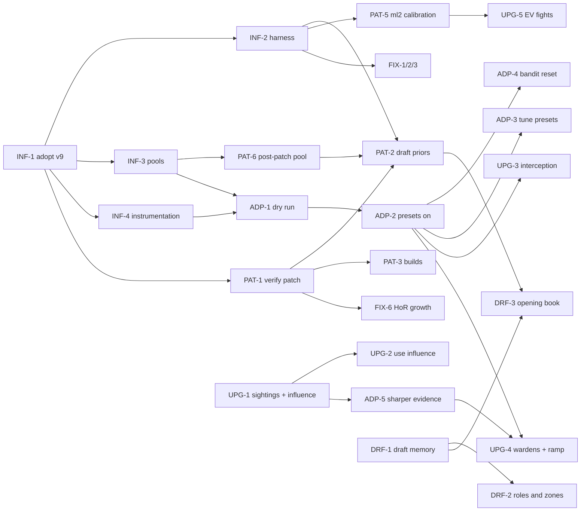

# GOD Bot: Improvement and Strategy Specification

- **Audience:** an implementing agent (or engineer) who will improve the team's CAMBC 2026 C++ bot "GOD".
- **Baseline code:** GOD v8 (`god.zip`, 16 files, 9,496 lines, 399 tunable parameters).
- **Companion code:** `god_v9_adaptive.zip` = v8 + the adaptive layer and fixes described here (10,052 lines). Every new switch defaults to v8 behaviour.
- **Rules baseline:** Cambridge Battlecode 2026, event `cambc2026a`, patch 3.0 and the Week 2 patch notes (20 Oct 2026).
- **Strategy reference:** Ian Millington, *AI for Games*, 3rd edition (CRC Press, 2019). Page numbers are the book's printed page numbers. Every quoted sentence was checked against the book's text.
- **Prepared:** 21 October 2026.

> **Status in one paragraph.** GOD v8 is a strong rule-and-utility bot. It is excellent at farming economics and at not dying, but it has no model of the opponent's *strategy*. Its only team-level adaptation is a three-arm "stance" bandit that changes at most once per 40 rounds. The companion v9 code adds an opponent model that switches the whole team between seven plans (FARM, DEFEND, PUNISH, HUNT, RACE, EVADE, DENY), plus six smaller fixes. All of it is compile-checked against a declarations-only SDK stub, and the opponent model passed ten scripted C++ scenario tests. **None of it has been played in a real match yet.** A new balance patch (§1.8: Ren, Stellar and Heart of Ruin nerfed; Tavi, Prism, Vendetta and Vesper Vale buffed) makes GOD's hard-coded draft priors and some build lists out of date, so adapting to the patch is the first work in the plan. This document says what to validate, what to build next, how to build it, how to measure it, and in what order.

---

## 0. How to use this document

### 0.1 Reading order

| Section | What it gives you | Read when |
|---|---|---|
| 1. Background | The rules and v8 internals that the work depends on | Before touching code |
| 2. What v9 already contains | Switches, files and test results of the companion code | Before planning |
| 3. Diagnosis | 13 weak points of v8, with `file:line` evidence | Before choosing work |
| 4. Making GOD win: the strategy | The adaptive layer, the ranked improvements, the principles | To understand *why* |
| 5. Counter-strategy playbook | Opponent type, signals, plan, behaviour | When tuning or debugging plans |
| 6. Strategies from *AI for Games* | Book techniques mapped to concrete work items | When designing a work item |
| 7. Work items | The backlog: one self-contained spec per item, with methods, code sketches and acceptance tests | While implementing |
| 8. Testing and evaluation protocol | Sparring pool, metrics, sample sizes, A/B order, checklists | Before every promotion |
| 9. Execution plan | Phases, dependencies, gates, timeline, risks | To schedule the work |
| Appendices | Parameter tables, shared-memory map, glossary | Reference |

### 0.2 Conventions

- **IDs.** `INF-n` infrastructure, `FIX-n` fixes, `ADP-n` adaptive layer, `UPG-n` new capabilities, `DRF-n` draft and opening, `REL-n` release. Each ID is defined once in section 7 and used everywhere else.
- **Status tags.** **[CODED]** is in the v9 zip behind a switch that defaults to off. **[DESIGN]** is specified here but not coded. **[PROCESS]** is tooling or testing work.
- **References.** `file:line` refers to the **v8** source unless it is marked *v9*. Function names are given as well, because line numbers drift. A v9 function index is in §1.7.
- **Parameters** live in `src/params.h`, `struct Params`. Submitted builds use `inline constexpr Params P{}`, so a value is changed by editing its default. A "switch" is an `int` parameter where 0 reproduces v8.
- **Book references** are written (§section, p. page).

### 0.3 Golden rules for the implementing agent

1. **Every behaviour change goes behind a switch whose default reproduces the current submitted behaviour.** Turn it on only after the A/B gate in §8 passes.
2. **Do not change an existing v8 default because it "looks wrong".** Most were set by evolution-strategy self-play or A/B tournaments. Change them only through the same A/B process.
3. **Fuel is hard-capped at 100,000 instructions per turn** (C++). An overrun suspends the bot until the next round. Every new per-turn loop must be bounded, guarded by `bc::fuel_remaining()` the way v8's scoring loops are, and profiled (REL-1).
4. **Shared memory is 8 bytes and all 64 bits are used in v9** (Appendix B). The only time-shared channel is the alert slot (bytes 6–7). Never take a bit without updating the map.
5. **Never ship `stub/cambc.h`.** Never submit with `spar_*` parameters set, or with `OPP_TRACE` or `LEGEND_TRACE` defined.
6. **`opp_plan = 1` requires `alert_refresh = 0`** (the v8 default), because bit 7 of byte 2 becomes the contact bit.
7. **Keep a fallback.** Keep the last accepted build ready to resubmit, and promote a new build only on evidence.
8. **Log every decision** in a changelog: switch, games played, metric, confidence interval, decision.

---

## 1. Background the agent needs

### 1.1 Competition and win condition

- The first team to **tribute 1,000 gems** wins at once. At round 2,000 the tiebreaks are: tributed gems, then **lifetime gold earned**, then champion kills, then Team B.
- **Only tributed gems count.** A camp that kills a carrier destroys its bag. A champion that kills a carrier **steals the bag and also gets 100 gold**.
- **The economic loop:** kill a camp group → capture it (stand on one of its tiles for 5 rounds, uncontested) → carry the gems → tribute them at an altar (a channel of ⌈gems/10⌉ turns) → spend the gold on shards at spawn.

### 1.2 Rules the improvements depend on

| Mechanic | Rule (patch 3.0 / Week 2) | Why it matters here |
|---|---|---|
| Camps | Wolf 1,350 HP / 20 Str / range 3 / 40 gold / 4 gems / 40-round respawn. Elk 2,400 / 60 / **4** / 90 / 15 / 60. Golem 5,000 / 120 / **4** / 160 / 36 / 80. Gem cluster 120 HP / 7 gems / 50. Gold cluster 120 HP / 20 gold / 50. Monolith 20,000 / 200 / **5** / 300 / 200 / 150. Monsters sleep until hit, then attack the nearest champion in range every round until they die or are left alone for 2 rounds. They never chase. | FIX-1 (safety range), FIX-4 (ring reach), objective plans |
| Groups | Cardinally connected monsters form one group: rewards add up, the group is captured once, and it respawns together | Farming unit |
| Capture | 5 rounds on a dead group's tile. It resets if the region is left empty or an enemy enters. The reward is split among allies present | Denial: stepping on a tile of an enemy capture resets it |
| Recall | 5 turn-ends (3 with the Home emblem). **Any damage, stun or death cancels it.** Gems are kept | Interception (UPG-3): one hit stops a recalling carrier |
| Tribute | max(1, ⌈gems/10⌉) turn-ends. **Damage does not stop it; a stun, a death or a new altar lock does.** The whole bag is banked at completion | Interception and altar control (UPG-3, UPG-4) |
| Death | 60-round respawn. The killer gets the bag + 100 gold; a camp kill destroys the bag. Cassi & Issac die together | Value of kills and of carrier hunting |
| Spawn | Heals fully at turn end; enemies cannot enter; shopping only there (Tavi anywhere) | Safety and retreat logic |
| Vision | 8 tiles, symmetric shadowcasting; walls and bushes block; a ward adds 6. **Vision is not shared between teammates** | Why shared sightings (UPG-1) matter |
| Wards | One per champion, placed within 2 tiles, permanent, recharges over 10 turn-ends | Warden vision (UPG-4) |
| Altar lock | Consumable, 10 gold, placed within 2 tiles of an altar. It blocks enemy tributes and **cancels a tribute in progress**; 5 hits to clear | The strongest denial tool (UPG-4) |
| Teleport crystal | 10 gold, reaches 3 tiles after a 3-turn channel | Island maps |
| Shop | Shards cost 30 gold and add one stat's growth. 5 of a family make an emblem: Monster +10% damage to camps; Power counts as 6 shards; Durability −10% damage taken; Treasure +20% gold; Jungle −30% damage from camps; Home recall in 3; Bruiser 5 shards + 1 of each other stat | Builds (FIX-5) |
| Actions | Move 1 tile (8 directions); dashes 2 steps (may cross holes, not walls). Basic attack = Str (melee range 1, ranged range 3). Ranged champions cannot walk and attack in one turn. One successful cast per turn; each slot has an 8-turn cooldown; attack resets restore the attack | Damage models |
| Turn order | Round start: respawns, ward updates, captures, camp attacks. Then champion turns alternate between teams (the first team swaps every round); within a team, higher priority acts first | Within a team, turns are sequential, so read-modify-write on shared memory is safe |
| Fuel | 100k instructions per turn; 10× on the first draft turn, 2× on the first game turn; an overrun suspends the bot until next round | REL-1 |
| Memory | 8 bytes shared by the team for the whole match. 1,024 bytes written in the draft, **read-only in the game** | ADP and UPG-1 bit budget; DRF-1 |
| Tavi | Ranged. Str 45 (+5), HP +75 and Focus +10 per shard; base HP 900 and Focus 110 after the new patch (§1.8). Slot 0: attack reset. Slot 1: 1.4×F damage + stun, range 4. Buys shards anywhere | FIX-5 |
| Heart of Ruin | The rules file says +15 focus and +5 strength per shard. Code comments cite a 3.0.2 hotfix to +12 focus and +4 strength. The new patch notes ("Strength per shard 4 → 3.5") confirm the hotfix's strength value, so its +12 focus is likely right too | FIX-6, PAT-1 |
| Week 2 patch | Wolf and elk rewards cut hard (wolf 22→4 gems, elk 36→15). Elk range 3→4 and monolith 3→5. Kills 50→100 gold. Ward cooldown 1→10. Altar-lock HP 3→5 | Value moved to clusters, golems, monoliths and kills; fights snowball |

### 1.3 Code layout (v8; v9 adds `opp.h` and `opp.cpp`)

| File | Lines (v8) | Role |
|---|---|---|
| `main.cpp` | 29 | Loop: draft or `brain().turn()`, `catch (...) {}`, `end_turn()` |
| `brain.cpp` / `brain.h` | 5,940 / 316 | All decisions: cascade, combat, safety, banking, shopping, farming, alerts |
| `world.cpp` / `world.h` | 609 / 193 | Map analysis, groups, distance fields, perception, beliefs about enemies and camps |
| `nav.cpp` / `nav.h` | 516 / 53 | Movement on goal-rooted distance fields, danger detours, crystals |
| `comms.cpp` / `comms.h` | 99 / 42 | The 8-byte shared-memory protocol |
| `learn.cpp` / `learn.h` | 161 / 66 | Stance bandit, fight calibration, pain map (off) |
| `draft.cpp` / `draft.h` | 610 / 10 | Map classification and the champion draft |
| `params.h` | 670 | All tunables (399) |
| `ml2_model.h` | 28 | Logistic weights: P(die within 8 rounds), P(kill within 8 rounds), 58 features |
| `common.h` | 154 | Kit reading (`kit_of()`), shared helpers |

### 1.4 How v8 decides (the parts the work touches)

**Turn pipeline.** `Brain::turn()` reads its own state, perceives (`World::perceive`), reads shared memory (`Comms::read`), runs housekeeping (learning tick, alerts, danger map, shop, `update_mode()`), then tries a **priority cascade**. The first function that returns `true` uses the turn:

```
combat → safety → tribute → home_trip → shop_trip → respond_to_alert → farm
```

**`update_mode()`** recomputes this turn's thresholds: base values → stance (SPREAD / GROUPED / PUSH) → scoreboard → deficit → gem race → (v9) the plan preset, applied last with floors.

**Farming (`group_score`, `farm`).** Each camp group is scored:

```
score = value / max(1, time)
value = (gems + gold_v × gold) × share  [× (1 + deny_bonus) on their half; × 0.75 if unseen 60+ rounds]
time  = approach + wait + kill + 6 (capture) + trips × trip_cost
        + enemy_half_penalty × risk (their half) + 12 if an enemy was near it in the last 12 rounds
gold_v = 0.33 × min(1, rounds_left / 500)   (× 0.3 when losing the gem race)
```

A new target must beat the current one by 15% (`hysteresis 1.15`), and the current target's score is doubled while it is being hit (`commit_hit 2.0`). Claims in shared memory stop duplicate work.

**Fighting (`combat`).** `adv = t_kill_us / t_kill_them × e^fight_bias` (Lanchester-style, support-aware). The bot fights at `adv ≥ 1.30` (`fight_margin`), hits back when in reach at `≥ 0.873`, trades when cornered at `≥ 0.741`, and attacks a channelling target at `≥ 0.9`. **Vetoes:** HP < 25% with an escape; a bag of 40+ gems and adv < 1.5; half the team dead; isolated and adv < 1.2335; on the target's spawn; and the learned model **P(die within 8 rounds) ≥ 0.20** (`ml2`, logistic, 58 features, trained on 203 games and 326,315 rows). A boosted-tree version exists but is off (`ml2_gb`: AUC 0.829 against 0.806).

**Safety (`safety`).** It retreats below `max(0.25 × max_hp, 4 × Σ Str of awake camps within 3 that target us, 1.2 × visible enemy burst)`. The "within 3" is finding 4.

**Banking (`tribute`).** Bank at 54 gems (22 before round 150). Also bank when risky (≥10 gems with an enemy within 9), near an altar (within 5), on the way, at the end-game, or when the team's bags win. Escort banking: a bag of 60+ gems at a "hot" altar waits for two healthy allies and posts an ESCORT alert.

**Team learning (`learn.cpp`).** Every 40 rounds the leader (body 0) scores the stance it played and picks the next by `argmax(q + context)`. Priors: SPREAD 0.3, GROUPED 0, PUSH −0.718. No exploration. **Fight calibration** per body: `fight_bias` drops 0.326 after a death within 8 rounds of a chosen fight and rises 0.163 after a kill, bounded to [−0.6, +0.3]. **Gem-race mode:** from round 150, sampled every 25 rounds; if they would finish 73+ rounds before us, gold is worth ×0.3, and if our fights also go well, deny +0.5, enemy-half ×0.5, fight margin −0.15, and carriers with 30+ gems become OPPORTUNITY targets.

**Alerts (one shared slot).** RALLY (a fight: come help, answered from ≤9 tiles at ≥60% HP), OPPORTUNITY (an enemy tributing or carrying: punish it, answered from ≤12 tiles at ≥40% HP, or ≤16 tiles at ≥25% once the enemy has 800+ banked), ESCORT (posted with the DANGER code: protect a big bag). RALLY, OPPORTUNITY and ESCORT expire after 6 rounds. A real DANGER ("avoid this place") is never posted, because `alert_radius = 0`.

### 1.5 Shared memory (8 bytes)

| Bits | v8 use | v9 use |
|---|---|---|
| Bytes 0–5, bits 0–5 (bits 0–6 when the bag sum is off) | Claimed group id + 1 per body (0 = none) | unchanged |
| Bytes 0–5, bit 6 | 6-bit team bag sum in tens of gems (`team_bank`, maps with ≤62 groups) | unchanged |
| Bytes 0–1, bit 7 | Team stance (2 bits, leader writes) | unchanged |
| Byte 2, bit 7 | Alert-refresh toggle, only if `alert_refresh = 1` (off) | **Contact bit**: any body that sees an enemy deep in our half sets it; the leader reads and clears it each round |
| Bytes 3–5, bit 7 | unused | **Team plan** (3 bits, leader writes) |
| Bytes 6–7 | Alert: bits 0–13 tile index (y·W + x), bits 14–15 kind (0 NONE, 1 DANGER/ESCORT, 2 RALLY, 3 OPPORTUNITY) | unchanged. UPG-1 proposes kind 0 with a non-zero tile = SIGHTING |

### 1.6 Parameters, builds and tooling

- **Submitted build:** `inline constexpr Params P{};`. Change a default to change behaviour.
- **Training build** (`LEGEND_RUNTIME_PARAMS`): the values come from a generated `params_rt.cpp`. The comments name `tools/rl/a100/es_a100.py` (evolution strategies). That tooling is in the team's repository, not in `god.zip`; use it if it is available.
- **Sparring proxies of ladder teams** are built from GOD itself with parameters: `mapdraft` (other teams' draft tables), `build_style` 3/4/10/12 (other teams' builds), `style 1` (deathball), `deathball_until`.
- **Debug flags:** `LEGEND_TRACE` (fuel warnings below 15k and more), `OPP_TRACE` (v9: one line per 30-round window from the opponent model). Output goes through the SDK's `debug_block`.

### 1.7 Function index (v9 line numbers)

| Function | Line | Function | Line |
|---|---|---|---|
| `Brain::turn()` | 650 | `Brain::update_mode()` | 3439 |
| `Brain::shop()` | 1139 | `Brain::sparring_window()` | 3640 |
| `Brain::build_danger()` | 1212 | `Brain::enemy_on_our_half()` | 3645 |
| `Brain::use_locks()` | 1762 | `Brain::tribute()` | 3686 |
| `Brain::place_ward()` | 1810 | `Brain::respond_to_alert()` | 3809 |
| `Brain::wins_with()` | 1885 | `Brain::ring_dps()` | 4085 |
| `Brain::combat()` | 2152 | `Brain::ring_farm()` | 4131 |
| `Brain::post_danger()` | 2850 | `Brain::group_score()` | 4322 |
| `Brain::engage()` | 2880 | `Brain::farm()` | 4992 |
| `Brain::bag_needs_escort()` | 3257 | `Brain::spells_on_camp()` | 5476 |
| `Brain::home_trip()` | 3290 | `Brain::cast_en_route()` | 5548 |
| `Brain::safety()` | 3321 | `World::init_units()` / `World::perceive()` | world.cpp 321 / 402 |
| `OppModel::tick()` | opp.cpp 65 | `OppModel::close_window()` / `decide()` | opp.cpp 129 / 167 |
| `Learner::tick()` | learn.cpp 58 | `play_draft()` / `param_pick()` | draft.cpp 497 / 423 |

`draft.cpp` is unchanged in v9, so its line numbers are the same in v8 and v9: `prior()` 328, `pd_score()` 347, pick order `order_all` 428, first-pick rule 435, fallback list 593.

### 1.8 Latest balance patch (notes received 21 October 2026)

| Champion | Change | What it means for GOD | Work items |
|---|---|---|---|
| **Stellar** (nerf) | HP 750 → 650; HP per shard 75 → 65; Focus 85 → 70; Focus per shard 9 → 7 | Base spell damage −18%, focus growth −22%, more fragile. Stellar is GOD's **second pick** in the fixed order, with prior 0.95, so it is now over-valued | PAT-2, PAT-3 |
| **Heart of Ruin** (nerf) | Str 40 → 30; Str per shard 4 → 3.5; dash landing (S2) 1.75×F → 1.5×F | Weaker burst and basic attacks. "4 per shard" confirms the 3.0.2 hotfix values in the code comments (+12 focus, +4 strength), not the rules file (+15, +5), so FIX-6 is probably settled in favour of 12 (still verify) | PAT-1, PAT-2, FIX-6 |
| **Ren** (nerf) | Stun damage (S1) 1.25×F → 0.75×F (−40%) | Ren is GOD's **default first pick** (prior 1.0, first in `order_all`, first pick on most map types). His spell damage, farming DPS and burst all fall; his retaliation passive (0.2×F per attacker) is unchanged | PAT-2, PAT-3 |
| **Vesper Vale** (buff) | HP 900 → 1,000; Str 50 → 55 | A sturdier ranged gold farmer (+33% gold passive; lifetime gold is the second tiebreak). Prior 0.12 is probably too low; `pd_gold_vesper` (off) is worth testing | PAT-2 |
| **Vendetta** (buff) | HP 800 → 1,000 | A much sturdier diver (kills reset all its cooldowns). Expect opponents to pick it more, so diving compositions get stronger | PAT-2, PAT-6, playbook |
| **Tavi** (buff) | HP 750 → 900; Focus 100 → 110 | Stronger and sturdier. The per-shard growth is unchanged (+5 Str / +10 Focus), so the `tavi_str` estimate (≈5.6 against ≈1.75 damage per round per shard) still holds. Prior 0.33 is probably too low | PAT-2, FIX-5 |
| **Prism** (buff) | Passive focus per carried gem 1 → 1.5 | A Prism carrying 54 gems now gains +81 focus (was +54). Big bags make Prism much stronger, and an enemy Prism carrier is both a richer and a more dangerous target | PAT-2, PAT-4, FIX-4 |

**What adapts automatically.** Every in-game number (HP, strength, focus, growth, spell multipliers, ranges, live focus including Prism's passive) is read from the engine through `kit_of()`, `base_stats()` and live unit stats. Fight estimates, farming DPS, burst estimates, danger maps and the engine-driven stat chooser (`tail_stat`) therefore update by themselves.

**What does not adapt and must be updated:**
- the draft priors and fixed pick order (`draft.cpp:328–345`, `428`, first-pick rule `435`, fallback `593`);
- the typed build lists (`build_for`);
- the ml2 danger-model weights, trained on pre-patch games;
- the sparring proxies' copied drafts and builds (`mapdraft`, `build_style` 3/4/10/12);
- hand-set priors in v9 (`opp_dive_prior`).

These are the PAT work items in §7.1, and they come first in the plan (§9), because the draft affects every game.

---

## 2. What v9 already contains

### 2.1 Switches in the companion code

| Switch | Default | First test value | What it does | Where |
|---|---|---|---|---|
| `opp_plan` | 0 | 1 | Runs the opponent model on the leader, broadcasts the plan, and applies the plan's preset in `update_mode()` | `opp.h/.cpp`, `Brain::turn`, `update_mode`, `respond_to_alert`, `use_locks`, `comms` |
| `opp_presets` | 1 | 0, then 1 | 0 = dry run: the plan is computed, broadcast and traced but not applied | `update_mode` |
| `contact_bit` | 1 | 1 | Bodies share "enemy deep in our half" through bit 7 of byte 2 | `turn`, `comms` |
| `enemy_comp_init` | 0 | 1 | Reads enemy champion types and kits at start-up (`champion_name()` works without vision) | `World::init_units` |
| `safety_range` | 0 | 1 | `safety()` counts each camp at its real engine range (elk/golem 4, monolith 5), not 3 | `safety` |
| `watchdog` | 0 | 3 | After N consecutive turns that threw, plays a minimal fallback turn: bank if next to an altar, else hit a visible camp in range, else walk home | `main.cpp` |
| `ring_reach` | 0 | 1 | Objective ring: area reach = range + radius, and the blast is aimed at a tile next to the camp | `ring_dps`, `spells_on_camp` |
| `tavi_str` | 0 | 1 | Tavi's default (style 2) build list becomes the same sequence in strength; the focus flag of the other tables flips. The proxy styles 3/4/10/12 are unchanged | `build_for` |
| `spar_from`, `spar_to`, `spar_half`, `spar_deny`, `spar_fight`, `spar_db` | inactive | §8.1 | **Sparring personas only.** Between `spar_from` and `spar_to`: PUSH stance, enemy-half cost × `spar_half`, deny + `spar_deny`, fight margin + `spar_fight`, and with `spar_db` a deathball | `update_mode`, `farm` |
| Model tunables | see Appendix A.2 | | Window, EMA, thresholds, CUSUM, race guard, and so on | `params.h` |

### 2.2 Verification done so far

- **Compile check:** every `.cpp` compiles with `g++ -std=c++20 -fsyntax-only -Wall -Wextra` against `stub/cambc.h` (written from `BotAPICpp.md`), with no errors and the same 8 warnings as v8 (4 in `brain.cpp`, 4 in `nav.cpp`).
- **Equivalence by construction:** with every switch at its default, each changed code path reduces to the v8 expression. This was reviewed line by line, but it has **not** been confirmed in an engine (INF-1 does that).
- **Scenario tests** (`test/test_opp.cpp` links the real `opp.cpp` and scripts the evidence):

| # | Scripted opponent | Plan timeline | Verdict |
|---|---|---|---|
| A | Even farmer, 5% contact | FARM all game | Correct |
| B | Quiet farmer banking 1.6× faster; even trades | FARM → HUNT r152 → DENY r880 | Correct |
| C | Farmer, then invader from r400 (50% contact; kills at r430/r436) | FARM → DEFEND r436 | Correct, at the second death |
| D | Same invasion, no deaths | FARM → DEFEND r482 | Correct, 82 rounds after the start |
| E | Two lost team fights on their half (r300/302, r335/337) | FARM → EVADE r337 → FARM r422 | Correct |
| F | Invader with two kills until r600, then passive and slower | FARM → DEFEND r62 → FARM r662 | Correct |
| G | Invasion from r300 that we win | FARM → PUNISH r392 | Correct |
| H | Quiet faster farmer; we lose a champion every 50 rounds | FARM → RACE r152 → DENY r880 | Correct |
| J | Mid-match switcher: farmer, invader r400–700 (2 kills), then passive and 1.6× faster | FARM → DEFEND r436 → FARM r752 → HUNT r782 → DENY r1040 | Correct at every phase |
| I | False alarms: even farmer, bursty contact 8% / 12%, 200 seeds each | Left FARM in 15/200 and 44/200 games | Acceptable at 8%; tighten `opp_depth` if real traces look like 12% |

### 2.3 What v9 does not have yet

v9 does not yet have:
- real-match validation;
- adaptation to the new balance patch: draft priors, builds and danger-model calibration;
- tuned presets;
- shared sightings and an influence map;
- carrier interception and altar wardens;
- use of the draft memory, or an opening book;
- probability-based fight thresholds;
- the evaluation tooling.

All of these are in section 7.

## 3. Diagnosis: what holds v8 back

Fourteen findings, roughly in order of expected impact. Evidence is v8 `file:line`.

| # | Weak point | Evidence (v8) | Cost in a match | Fix |
|---|---|---|---|---|
| 1 | **No model of the opponent's strategy** | Team-level adaptation is only the stance bandit (`learn.cpp:115–155`) and the scoreboard/race modifiers in `update_mode()` (`brain.cpp:3407`) | A strategic response takes 40–200 rounds and can only pick among 3 stances | ADP-1…3 (coded), ADP-6/7 |
| 2 | **The stance bandit rarely reaches PUSH, and credits the wrong thing** | Priors SPREAD 0.3 / GROUPED 0 / PUSH −0.718, no exploration (`ucb_c = 0`, `learn.cpp:135, 146`). The reward is the window's outcome (`learn.cpp:128`), which depends on the opponent as much as on our stance | In practice a slow SPREAD/GROUPED switch. PUSH comes only after about three losing windows, as a desperate move (§3.1) | ADP-2 (the plan sets the stance), ADP-4 |
| 3 | **Vision is not shared; DANGER is switched off** | `alert_radius = 0` (`params.h:123`) makes `post_danger()` return at once (`brain.cpp:2826`). The DANGER code is now used only by ESCORT (`3733`), alert priority (`2707`) and death placement (`learn.cpp:94`). The A/B that turned it off (`params.h:95`: 47.1%) tested a *binary* zone (steps avoid it; groups inside cost a flat 25 rounds, `brain.cpp:4655–4656`) | Bodies walk into packs a teammate saw a round earlier; the leader cannot see an invasion | Contact bit (coded, part of ADP); UPG-1, UPG-2 |
| 4 | **`safety()` counts camps only within 3 tiles** | `brain.cpp:3310` skips every camp with `d > 3`, while elk/golem reach 4 and monolith 5 (acknowledged at `brain.cpp:4010`) | Damage taken at 4–5 tiles is under-counted, so the retreat starts late | FIX-1 (coded) |
| 5 | **Enemy composition is unknown until first sight** | `world.cpp:329` reads types only for `team::ally`; enemies start as placeholders with an empty kit (`world.cpp:346–347`) | No composition prior; unseen enemies have no kit in the danger maps | FIX-3 (coded) |
| 6 | **The objective "ring" ignores the area-spell radius** | `ring_dps()` (`brain.cpp:4012–4019`) needs `aoe_range ≥ max(3, max camp range) + 1` (5 on elk/golem, 6 on a monolith); `kite_dps()` repeats it at `4171` (used only by the disabled `mi_kite`). Elsewhere reach is `aoe_range + aoe_radius` (`1056, 2390, 2893, 5494`). The draft still adds +0.75 for Prism/Tavi on objective maps (`draft.cpp:354`) | The ring rarely qualifies on elk and golem groups, yet the draft keeps paying for it | FIX-4 (coded) |
| 7 | **Tavi builds focus; strength is probably worth about 3×** | Under build style 2, Tavi shares Stellar and Prism's focus list (`brain.cpp:286–303`); the other tables flag her as focus (`68, 105, 150, 195, 230, 362`) | Tavi scales about 3× slower than she could (§3.2) | FIX-5 (coded) |
| 8 | **Carrier hunting was planned but never built** | `gank_bag = 25` "chase a visible carrier…" (`params.h:591`) is never read. Carriers are chased only when seen tributing, recalling with 20+ gems, or in race mode (`brain.cpp:723–728`) | The cheapest swing in the game (bag + 100 gold + a 60-round death) is taken only by chance | UPG-3 |
| 9 | **Altar denial is opportunistic only** | OPPORTUNITY needs a body to *see* the tribute (`brain.cpp:723`). From 800 enemy gems the answer radius grows from 12 to 16 and the HP gate drops from 40% to 25% (`3751–3754`), but someone must be watching. Pre-emptive locks go only on enemy-side altars; elsewhere a lock is used only on a tribute a body is watching (`use_locks`, `1754–1767`) | Near their 1,000, nothing positions bodies at their altars | DENY preset (coded); UPG-4 |
| 10 | **The draft memory is unused** | The draft writes a 4-byte tag `{0xB7, 2, team, chosen}` (`draft.cpp:603–604`); nothing in the game reads it | Up to 1,024 bytes of planning (roles, zones, opening line) are wasted | DRF-1…3 |
| 11 | **A turn that throws is silently lost** | `main.cpp:17–19` `catch (...) {}` | A repeating exception idles a body for the rest of the game | FIX-2 (coded); INF-4 |
| 12 | **Small tuning samples; overfit to one week's proxies** | Many decisions rest on 24–112-game comparisons, e.g. `alert_refresh` "50.9% head-to-head" (`params.h:112`) | Some defaults are probably neutral or harmful; the bot is tuned to one ladder week | INF-2, §8 |
| 13 | **Heart of Ruin growth: rules and code disagree** | Rules +15 focus and +5 strength per shard; code comments cite the 3.0.2 hotfix, +12 and +4 (`brain.cpp:258`, `params.h:305`). The new patch notes ("4 → 3.5") support the hotfix values | Only typed builds and draft priors can be affected; in-game models read live values | FIX-6, PAT-1 |
| 14 | **Patch-sensitive hard-coded knowledge** | Draft priors (`draft.cpp:328–345`), fixed pick order (`428`), first-pick rule (`435`), typed build lists (`build_for`), ml2 weights (`ml2_model.h`, pre-patch games), sparring proxies | After the new patch (§1.8), GOD over-values Ren and Stellar, under-values Tavi, Prism, Vendetta and Vesper, and its danger model may be mis-calibrated | PAT-1…7 |

### 3.1 Why PUSH comes rarely, and late (finding 2, worked example)

Every 40 rounds the leader computes:

```
r = (0.67·diff + 0.33·prev_diff + 40.15·kills − 45·deaths) / 40
q[played] += 0.5·(r − q[played])            (unplayed stances keep their values: prior_pull = 0)
pref = q + 0.0075·(our deaths on our half) for GROUPED + 0.3·(kills − deaths) for PUSH + 0.15 for the current stance
stance = argmax(pref)
```

If we are out-banked by 2 gems per round:
1. SPREAD scores −0.52 after one window, so the bandit moves to GROUPED (pref 0).
2. GROUPED scores −1.0, so it returns to SPREAD (−0.52 beats −0.85).
3. SPREAD drops to −1.26, so only now does PUSH (−0.718) win, in the fourth window, after 120 rounds of losing.

PUSH is a desperate move, not an answer to an invader. A good window also lifts the stance that was playing, not PUSH: +40 gems and 2 kills raise q[SPREAD] from 0.3 to 1.49.

### 3.2 The Tavi estimate (finding 7)

- **Strength:** +5 strength per shard. Tavi's slot 0 is an attack reset with an 8-round cooldown, so she attacks about 1 + 1/8 = 1.125 times per round when attacking every round. That is 5 × 1.125 ≈ **5.6 damage per round per strength shard**.
- **Focus:** +10 focus per shard. Her only damage spell is 1.4×F every 8 rounds, which gives 1.4 × 10 / 8 = **1.75 damage per round per focus shard**.

Caveat: ranged champions cannot walk and attack in the same turn, so basic-attack uptime is below 100%. Strength still wins unless uptime is under about 31%. The new patch raised Tavi's base HP and focus but not her per-shard growth, so the estimate is unchanged. Decide by A/B.

---

## 4. Making GOD win: the strategy

### 4.1 The core idea

GOD's facts are dynamic, but its thresholds are fixed. The fixed thresholds are an *average* answer to the opponents GOD was tuned against. Against a specific opponent, especially one that changes strategy mid-match, the right thresholds differ, and v8 cannot move them coherently.

The fix is a **strategy tier** above the existing cascade. It interprets what the opponent is doing, picks a team **plan**, and broadcasts it. Every body then applies that plan's **preset**, a coherent set of about ten threshold changes, on top of the existing modifiers.

This is the book's multi-tier architecture: "The first task for the AI is to interpret what the player will be doing" (§6.4.1, p. 558). As the book also puts it, "If you are looking for highly intelligent high-level behavior, then you will always end up implementing it explicitly" (p. 563). GOD's emergent cooperation (claims, join rules) is excellent for farming. Strategy (invade, defend, deny, race) has to be explicit.

### 4.2 Three rules behind every counter-plan

1. **Trades, not presence, decide fight or flight.** An invader we beat is an opportunity (PUNISH). One that beats us is a threat (DEFEND).
2. **The race decides how much risk is worth taking.** If we are behind with even trades, take risks on their half (HUNT). If we are behind and losing trades, do not fight (RACE). Near their 1,000, everything goes to denial (DENY).
3. **Switch on evidence, stay on weaker evidence.** Use different enter and stay thresholds, two-window persistence and dwell times. Thrashing between plans is itself exploitable. The book notes that a change of behaviour "is far more conspicuous than the behavior itself" (§2.1.4, p. 24).

### 4.3 Ranked improvements (expected impact, highest first)

| Rank | Improvement | Why it wins games | Status / ID |
|---|---|---|---|
| 1 | **Adapt to the new balance patch:** draft priors, pick order, builds, danger-model calibration | The draft decides every game. v8's default first picks (Ren, Stellar) were both nerfed | PAT-1…7 [DESIGN] |
| 2 | **Opponent model + team plan** (7 plans with presets) | Replaces slow, implicit adaptation with an explicit counter-plan. It switches at the second of our deaths on our half, and about 80–100 rounds into a presence-only invasion | ADP-1…3 [CODED, untested in matches] |
| 3 | **Shared evidence** (contact bit now; sightings + influence map next) | Vision is per body; one bit per round already tells the leader "they are deep in our half" | contact bit [CODED]; UPG-1/2 [DESIGN] |
| 4 | **Carrier interception and altar control** (the DENY plan's executors) | A carrier kill is worth its bag + 100 gold + 60 rounds of their absence. An altar lock cancels a tribute | UPG-3, UPG-4 [DESIGN] |
| 5 | **Low-risk fixes:** safety range, watchdog, enemy composition at start | Fewer silly deaths; no idle bodies; earlier priors | FIX-1…3 [CODED] |
| 6 | **Post-patch regressions:** ring reach, Tavi strength | The ring is effectively disabled while the draft still pays for it; Tavi under-scales | FIX-4, FIX-5 [CODED] |
| 7 | **Draft memory and opening book** | 1,024 free bytes: roles, zones and the opening line, chosen with knowledge of the map and the enemy's picks | DRF-1…3 [DESIGN] |
| 8 | **Probability-based fight decisions** (+ the boosted-tree model trial) | Removes cliff-edge thresholds; uses P(kill8) and P(die8), which GOD already computes | UPG-5 [DESIGN] |
| 9 | **Testing that can tell a gain from noise** | Past A/B calls of 24–112 games carry ±9 to ±20 points of noise | INF-2, §8 [PROCESS] |

### 4.4 The adaptive layer: complete specification (implemented in v9 as `opp_plan`)

**Where it runs.** Only the leader (body 0) runs the model, once per round, **alive or dead**: the global facts need no vision. Every other body sets the contact bit when it sees an enemy deep in our half, and applies the broadcast plan's preset in its own `update_mode()`.

**Evidence that needs no shared vision:**

| Signal | Source | What it reveals |
|---|---|---|
| Their bank events | `bc::global_submitted_gems(team::enemy)`, exact, every round | When and how much they bank: pace, bag sizes, race projection |
| Our banked gems + bags carried | `global_submitted_gems(team::ally)` + the shared bag sum | Our side of the race. Bags count, so a big team bag does not trigger a race plan |
| Deaths on both sides | Global alive flags (`World::ally_deaths`, `enemy_deaths`) | Trade balance; lost team fights (a second death of ours within 4 rounds) |
| Where our dead were farming | Each ally's last claim in shared memory, if held within 8 rounds of its death, on a group with `ours` set | Deaths on our own half even when nobody saw them |
| Contact | Any body sees a living enemy, off its spawn, with `dist_home + 2 < opp_depth (0.8) × dist_away` | Invasion share. Midline groups that both teams farm are excluded, which keeps false alarms down |
| Composition | `champion_name()` at start-up (`enemy_comp_init`) | Number of divers (melee or dash champions); the contact index starts at `0.15 × (divers − 2)` |

**Running indices, updated when each 30-round window closes:**

```
c          = share of rounds in the window with contact (own sighting OR shared contact bit)
contact    = 0.5·contact + 0.5·c                       (EMA)
hi_run     = consecutive windows with contact ≥ 0.35
cusum      = max(0, cusum + (c − mean_c) − 0.2);  mean_c = 0.85·mean_c + 0.15·c   (Page's CUSUM; alarm ≥ 0.8)
balance    = EMA_0.5 of (their deaths − our deaths) per window
home       = EMA_0.5 of our deaths on our half per window (max of the learner's count and claim-located deaths)
losses     = lost team fights in the last 100 rounds
rate_x     = max(0.05, 0.5·EMA_0.3(window banking pace) + 0.5·(banked / round))
t_us       = (1000 − ours − bags carried) / rate_us;   t_them = (1000 − theirs) / rate_them
behind     = round ≥ 150 and they finish before round 2000 and t_them + 60 < t_us   (+0 instead of +60 once racing)
```

**Plans and presets.** The preset is applied at the end of `update_mode()`, after the stance, scoreboard and race modifiers, with these floors: fight margin ≥ 0.9, fight-back ≥ 0.55, deny ≥ 0, isolated bar ≥ 1.0, bank threshold ≥ 10 gems. Base values for reference: fight margin 1.30, fight-back 0.873, enemy-half cost 10, deny 0.043, isolated 1.2335, bank 54, gold 0.33, rally radius 9, opportunity radius 12/16.

| Plan | Opponent pattern | Fight | Fight-back | Enemy half | Deny | Isolated | Bank | Gold | Stance | Rally / opp. radius | Locks on contested altars |
|---|---|---|---|---|---|---|---|---|---|---|---|
| FARM | Even, quiet | — | — | — | — | — | — | — | bandit | — | — |
| DEFEND | Invades and wins trades | +0.10 | 0 | ×2.5 | −0.05 | +0.2 | ×0.7 | ×1 | GROUPED | +3 / 0 | no |
| PUNISH | Invades but loses trades | −0.15 | −0.10 | ×0.6 | +0.30 | 0 | ×1 | ×1 | PUSH | +2 / +2 | no |
| HUNT | Quiet, out-farms us, trades even | −0.10 | −0.05 | ×0.4 | +0.50 | 0 | ×1 | ×0.8 | PUSH | 0 / +4 | yes |
| RACE | Quiet, out-farms us, trades lost | +0.30 | 0 | ×1.5 | −0.05 | +0.3 | ×1 | ×0.3 | SPREAD | 0 / 0 | no |
| EVADE | Wins team fights anywhere | +0.40 | 0 | ×1.5 | 0 | +0.4 | ×0.7 | ×1 | GROUPED | +2 / 0 | no |
| DENY | ≥ 850 banked and ahead in the race | −0.20 | −0.15 | ×0.4 | +0.60 | −0.1 | ×0.6 | ×0.5 | PUSH | +2 / +6 | yes |

"Fight" and "Fight-back" are added to the margins (lower = more aggressive). "Enemy half" multiplies the risk cost of their half. "Bank" multiplies the bag size that triggers an altar trip. The magnitudes are **starting points**; ADP-3 tunes them.

**Decision list (`OppModel::decide()`), checked when a window closes:**
1. Theirs ≥ 850 **and** `behind` → **DENY**.
2. No window closed yet → **FARM**.
3. Invasion: `hi_run ≥ 2`, **or** (plan is DEFEND/PUNISH **and** contact ≥ 0.20), **or** home ≥ 1 → **PUNISH** if balance ≥ 0.5 and home < 0.5, else **DEFEND**.
4. ≥ 2 lost team fights in the last 100 rounds → **EVADE**.
5. Quiet (contact ≤ 0.10, or ≤ 0.35 if already racing) **and** `behind` → **HUNT** if balance ≥ −0.25, else **RACE**.
6. Otherwise → **FARM**.

**Switching rule.** The chosen plan replaces the current one if it is *urgent* (CUSUM ≥ 0.8 and the plan is DEFEND, PUNISH or EVADE), or the current plan is FARM, or the current plan has run ≥ 2 windows (`opp_dwell`).

**Fast paths, checked every round:**
- From FARM: the second lost team fight within 100 rounds → **EVADE** at once.
- The second claim-located death of ours on our half within the current window → **DEFEND** (or **PUNISH** if balance ≥ 0.5) at once.
- Any round with theirs ≥ 850 where `decide()` returns DENY → **DENY** at once.

**Integration points (v9):**

| Place | Change |
|---|---|
| `opp.h`, `opp.cpp` (new) | Plans, presets, `OppModel::tick/close_window/decide`, `OPP_TRACE` line per window |
| `Brain::turn()` | After `C.read()`: each body computes `enemy_on_our_half()`; non-leaders set the contact bit; the leader takes and clears it, ticks the model and writes the plan. A dead leader keeps ticking |
| `update_mode()` | Reads the plan; a preset may force the stance; the numeric preset is applied last, with floors |
| `respond_to_alert()` | Answer radius + `rally_add` / + `opp_add` |
| `use_locks()` | With `locks_contested`, contested altars are locked too |
| `Comms` | Plan in bit 7 of bytes 3–5; contact in bit 7 of byte 2 |

**Detector tuning, done in simulation on bursty synthetic contact streams (episodes of mean length 5 rounds).** The best setting with ≤10% false alarms per 2,000-round game, against a farmer showing 8% background contact, was:
- window 30, EMA 0.5, enter at 0.35 for 2 windows, CUSUM k 0.2 / h 0.6–0.8;
- about **8.7% false alarms**;
- detection of a jump to 45% contact: **median 100 rounds, 90th percentile 190**.

20-round windows were too noisy. The depth filter and the death fast path matter more than the exact thresholds.

**Fuel.** A few hundred instructions per round on the leader, plus one decision per 30 rounds. Negligible.

**Known limits.**
- The scenarios script the evidence, not the game.
- Contact is per body, so a stealthy invader is caught by the death path, not the contact path.
- The race projection is lumpy (hence `opp_race_from = 150` and the hysteresis).
- The presets are untuned.

ADP-1…7 address these.

---

## 5. Counter-strategy playbook

The plan column is what v9 selects automatically. "Watch out for" is what to check in testing.

| Opponent does | Signals GOD sees | Plan | What changes | Watch out for |
|---|---|---|---|---|
| Mirror farming | Contact ≤ 0.10; equal paces | FARM | v8 economy: value per time, escort banking, early gold | Small edges decide it: bank timing, fewer heal trips |
| Faster farmer that avoids fights | Their pace ahead by ≥ 60 rounds to 1,000; low contact; trades even | HUNT | PUSH; enemy-half ×0.4; deny +0.5; carriers answered from +4 tiles; contested altars locked; gold ×0.8 | Over-extending into their spawn; isolated bodies (the isolated bar is unchanged) |
| Faster farmer that also wins fights | As above, trade balance < −0.25 | RACE | Avoid fights (+0.3, isolated +0.3); farm our half; gold ×0.3; SPREAD | If they turn to invading, the DEFEND path takes over |
| Early rush / invader that wins trades | Contact ≥ 0.35 for 2 windows, or 2 deaths on our half in a window | DEFEND | GROUPED; enemy-half ×2.5; bank ×0.7; rally +3; fight +0.10 | Turtling too long: it leaves once contact < 0.20 after 2 windows |
| Invader that loses trades | Same, with balance ≥ 0.5 | PUNISH | PUSH; fight −0.15; deny +0.3; enemy-half ×0.6 | Chasing at low health: `safety()` still comes first |
| Team-fight specialist | 2 lost team fights (2+ of our deaths within 4 rounds) in 100 rounds | EVADE | GROUPED; fight +0.4; isolated +0.4; bank ×0.7 | Lower income; returns to FARM as the losses age out |
| Carrier sniper | Deaths with big bags; home deaths | DEFEND | Smaller banks; escort banking (`escort_bag` 60; try 40) | Escorts slow farming; A/B the escort size |
| Altar camper | Tributes cancelled; deaths at altars | DEFEND | Escort; contested-altar cost; bank smaller and earlier | Needs influence-aware altar choice (UPG-2) |
| Objective or monolith stacker | Big bank events (100+ gems); many bodies seen together | HUNT, later DENY | Farm everything else; deny their capture by stepping on one of its tiles (resets the 5-round capture), or catch the carriers as they leave | A five-body stack wins a straight fight |
| Late all-in near 1,000 | Their banked ≥ 850 and they lead the race (finish ≥ 60 rounds before us) | DENY | Deny +0.6; fight −0.2; opportunity +6; contested locks; bank ×0.6; wardens (UPG-4) | Leaving our own farm too early: DENY needs them ahead in the race |
| Strategy switcher | Signals alternate | Follows | Each switch needs 2 windows (or hard evidence); counter-plans dwell 2 windows | Over-reaction; check plan timelines with `OPP_TRACE` |
| Diving composition (more likely after the Vendetta buff) | Many melee or dash picks (`enemy_comp_init`) | DEFEND sooner | Contact index starts at 0.15 per diver beyond the second | The prior never switches the plan alone |
| No-altar or stalling map | No usable altar | FARM (gold mode) | Gems count 0; groups scored by gold | Tiebreak order: gems, lifetime gold, kills, Team B |

**After the new patch (§1.8), expect opponents to:**
- move away from Ren and Stellar;
- pick more Tavi, Vendetta, Vesper Vale and Prism.

What that means for GOD:
- **Enemy Prism carriers** become both richer and more dangerous as their bag grows (+1.5 focus per gem). The fight model reads their live focus, so its estimates adjust by themselves. Interception (UPG-3) should still prefer them when they are alone.
- **Vendetta's 1,000 HP** makes diving compositions sturdier, so DEFEND should trigger on the death path more often.
- **Vesper's gold passive** makes the lifetime-gold tiebreak more relevant on stalled maps.

---

## 6. Strategies from *AI for Games*, applied to GOD

Each row gives:
- the book's idea, with its location;
- what GOD already does;
- the work item that applies it.

Quotes are verbatim, and the page numbers are printed pages.

| Book idea (§, page) | What GOD already does | What to do next (work item) |
|---|---|---|
| **Knowledge vs search** (§1.1, pp. 6–8): "The more knowledge you have, the less searching for an answer you need" (p. 6) | Analytic kill and damage models, tuned thresholds and a learned danger model, all within 100k fuel | Add the cheapest high-value knowledge: *what strategy the opponent is playing* (ADP-1…3) |
| **Changes of behaviour are conspicuous** (§2.1.4, p. 24); **stable decisions** (§5.2.9, p. 311) | Hysteresis, commit-hit, flip margin, sticky tributes, fight commitment | The same discipline for plan switches: 2-window evidence, dwell time, separate enter and stay thresholds (done in v9) |
| **Heuristics: most constrained, most promising first** (§2.2.2, p. 27) | `score_cap` pruning; nearest groups scored first | Assign heavy groups to the bodies that can solo them *before* greedy farming (DRF-2) |
| **Pursue with prediction** (§3.3.8, pp. 68–72) | The danger radius grows with a sighting's age | Intercept carriers at their *predicted* path to an altar or spawn (UPG-3) |
| **Soft roles** (§3.7.7, pp. 158–160): "roles that can be broken" (p. 159) | Claims and join limits | Zone ownership per body as a small score bonus, set in the draft (DRF-2) |
| **Hierarchical state machines** (§5.3.8, pp. 323–324): "the highest state in the hierarchy is always in control" (p. 324) | A flat task state machine under a priority cascade | A strategy state (the plan) above the cascade (done in v9) |
| **Markov state machines** (§5.6, pp. 399–405) | None for the opponent | The opponent belief decays toward FARM when evidence stops (v9 EMAs + stay threshold); a learned classifier later (ADP-6) |
| **Goal-oriented behaviour with timing** (§5.7.3–5.7.4, pp. 410–415): "If the character is taking a beating, it will automatically act more defensively" (p. 415) | Value / time farming with heal trips | Two-step plans: farm A then capture-recall; farm A then bank (UPG-7) |
| **Rule arbitration with dynamic priority** (§5.8.5, pp. 444–446): "allows the rule to gradually get more important" (p. 446) | A fixed cascade order; step changes at 800 and 850 enemy gems | A smooth denial-urgency ramp with their banked total (UPG-4) |
| **Fuzzy logic** (§5.5, p. 374) vs probability: "it is always better to use probability to represent any kind of uncertainty" (p. 375) | Hard cut-offs (1.30 / 0.873 / 0.741) | Fight on P(kill8) and P(die8) expected value, not fuzzy sets (UPG-5) |
| **Blackboard** (§5.9, p. 461) | The 8-byte shared memory | Spend bits on what is scarcest: the plan and the contact bit (done); sightings via the idle alert slot (UPG-1) |
| **Influence maps** (§6.2.2, pp. 512–519): "The location with the smallest security value is often a good place to launch an attack" (p. 517); with partial information keep "one set of tactical analyses per side" (p. 518) | Next-turn danger bitboards; "+12 if an enemy was seen near it within 12 rounds" | A decaying per-side influence map from own sightings + shared sightings (UPG-1), used for routing, scoring and wards (UPG-2) |
| **Frag maps / learning tactical analyses** (§6.2.4, pp. 521–523): "the AI repeatedly using a tactic that obviously fails" looks stupid (p. 522); "it may be beneficial to forget even more quickly" (p. 523) | The pain map exists but is off in v8 | A two-sided map (where we die / where we kill) with fast forgetting, tested against switching proxies (UPG-6) |
| **Tactical pathfinding** (§6.3, pp. 548–553): "An infantry unit might not mind enemy contact if it is healthy" (p. 551) | A binary danger detour | Cost = steps + w × threat, with w rising with the bag and falling with HP (UPG-2) |
| **Multi-tier AI** (§6.4.1, pp. 554–561): "The first task for the AI is to interpret what the player will be doing" (p. 558); orders through an "in-tray" (p. 560) | The leader body chooses only the stance | Strategy tier = opponent model + plan broadcast (done); per-body roles later (DRF-2, UPG-4 wardens) |
| **Scripted group actions** (§6.4.3, pp. 564–567): "Adding just signals and waits" enables collaborative sequences (p. 565) | Rally / escort / gather waits | Two-body plays: altar ambush, objective dive, escort-bank (UPG-4, UPG-7) |
| **Parameter modification** (§7.2, pp. 579–592): "The best parameter value will change over time as the player behaves differently" (p. 581) | Offline ES self-play | Tune *per plan*, each preset against the opponent type it counters (ADP-3) |
| **Action prediction / N-grams** (§7.3, pp. 592–602): window size and a confidence threshold "(say, 3 or 4)" (p. 599); predicting "where players will be" (p. 602) | None | Predict their next bank time from bank cadence, and their next camp from sighting sequences (ADP-7, UPG-3) |
| **Naive Bayes** (§7.5, pp. 604–609): "Naive Bayes classification, is what you should always try first" (p. 604) | A logistic danger model | An opponent-archetype classifier on labelled self-play windows, replacing hand thresholds (ADP-6) |
| **Reinforcement learning** (§7.7, pp. 627–639): struggles "where the strategies that are successful change over time" (p. 639) | A greedy 3-arm stance bandit | Do not rely on RL against a switching opponent: detect the switch, then reset or condition the learner (ADP-4) |
| **MCTS** (§9.5, pp. 776–783): exploration vs exploitation (p. 779) | — | Too expensive for whole turns at 100k fuel; at most a 1–2 ply check of a burst exchange (optional, not scheduled) |
| **Opening books** (§9.6, pp. 783–785): self-play records the lines "that are most favorable" (p. 784) | Per-map draft tables (inactive) | An opening book keyed by map features, passed through the draft memory (DRF-3) |
| **Learning weights by matches** (§9.8.2, pp. 794–797): "play two versions of the AI against one another" (p. 795) | The A/B tournaments | The same, with enough games and paired designs (INF-2, §8) |
| **Scheduling, anytime algorithms, level of detail** (§10.1–10.3, pp. 804–834): hysteresis between LOD levels (p. 826) | Fuel floors, lazy fields, resumable scans | Run cheap per-round updates and expensive analyses every N rounds (UPG-1 blur every 3 rounds; plan decisions every 30) |
| **Event managers** (§11.2, p. 846): "a secure radio link between members of an AI team" | One alert slot | Treat the contact bit and the sighting channel as the cheapest event channel (UPG-1) |
| **RTS and MOBA design** (§14.4.4–14.4.5, pp. 953–954): RTS AI "almost always require[s] a multi-tiered AI approach" (p. 953) | Per-body cascades | The strategy tier is the missing layer (§4) |

**Errata to know when implementing from the book.**
- **p. 515:** the influence radius is printed as r = I₀/(I_t − 1). From I₀/(1 + r) = I_t, it should be **r = I₀/I_t − 1**.
- **p. 513:** "double the distance and we get half the influence" is exact only if you double (1 + d), not d.
- **p. 781:** the UCT pseudo-code divides by `next.wins`. The formula on p. 779 divides by **playouts**; use playouts.
- **pp. 807, 815, 819:** the scheduler test `behavior.frequency % (frame + behavior.phase)` has its operands reversed. Use `(frame + phase) % frequency == 0`.
- **pp. 634–635 vs p. 639:** the Q-learning default parameters are inconsistent. Do not copy them blindly.

---

## 7. Work items

Every item gives: priority (P0 = do first … P3 = optional), effort (S ≤ ½ day, M 1–3 days, L 3+ days of agent work, excluding game-running time), status, dependencies, then **Problem → Goal → Method → Acceptance → Risks**. Code blocks marked *sketch* show the shape of the change. Adapt names to the real signatures.

**Acceptance vocabulary** (defined precisely in §8.4):
- **non-inferior**: the lower 95% bound of the paired gem-margin difference is ≥ −10 gems, **and** the win-rate difference's lower bound is ≥ −2 points;
- **superior**: the lower 95% bound of the paired margin difference is > 0.

### 7.1 Patch adaptation (new balance patch, §1.8)

#### PAT-1 · Verify the patch numbers in the engine
**P0 · S · [PROCESS] · depends on INF-1**

- **Problem.** The patch notes are text. GOD reads live values, but its hard-coded priors and lists assume old numbers, and the Heart of Ruin growth was already disputed (finding 13).
- **Goal.** A verified table of base stats, growth per shard and spell multipliers for all 13 champions under the current engine.
- **Method.**
  1. In a debug build, at the end of `World::init_units()`, print through `debug_block` each ally's and enemy's (with `enemy_comp_init = 1`) type, HP, strength, focus, and the kit (`dmg_mod`, `cc_mod`, `aoe_mod`, `dash_mod`, ranges, radius).
  2. For growth, buy one shard of each stat in a scripted test game and log the stat delta.
  3. For Prism, log focus against carried gems over a few captures (expect +1.5 per gem).
  4. Compare with §1.8 and record the result in the changelog.
- **Acceptance.** The table exists; every patch line is confirmed or contradicted; FIX-6 is closed.
- **Risks.** None. This is a debug build only.

#### PAT-2 · Re-derive draft priors, pick order and first-pick rule
**P0 · M (plus game time) · [DESIGN] · depends on PAT-1, INF-2, INF-3**

- **Problem.** `prior()` (`draft.cpp:328–345`) has Ren 1.0, Stellar 0.95, C&I `pd_ci_prior`, Varg 0.62, Ryth 0.6, Prism 0.36, Tavi 0.33, Vendetta 0.3, Marcella 0.2, Vesper 0.12, HoR `pd_hor_prior`, others 0.1. The fixed `order_all` (`428`) starts Ren, Stellar. The first pick is Ren on most map types (`435`). Ren, Stellar and HoR were nerfed; Tavi, Prism, Vendetta and Vesper were buffed.
- **Goal.** Priors and order that reflect each champion's measured marginal value under the new patch, per map class.
- **Method.**
  1. **Make the priors tunable.** Add `pd_prior_<champion>` parameters, defaulting to the current numbers, and read them in `prior()`. Also make the first-pick choice per `pd_type` a parameter. With defaults the draft is unchanged.
  2. **Measure marginal value with a swap test.** For each map class (objective, lone monolith, packs, open, no-altar), take the composition GOD drafts today as the base B. For each slot s and each candidate champion c, play paired games of B with s replaced by c against the same opponent pool. The mean paired gem-margin change Δ(c, s) estimates c's value relative to the incumbent. About 60–100 pairs per (class, c) gives a usable ranking. Use the paired design (§8.2).
  3. **Set priors** ∝ the mean Δ over slots, normalised so the best champion = 1.0. Re-derive `order_all` from the new priors. Choose the first pick per map class from the top Δ.
  4. **Re-test the draft-only knobs:** `pd_gold_vesper` (off; Vesper was buffed), `pd_hor_prior`, `pd_hor3`, `pd_counter_hor`, and the objective-map +0.75 for Prism/Tavi (FIX-4).
  5. **Validate** the new draft against the old one in a paired tournament on all official maps, both sides.
- **Acceptance.** Non-inferior on every map class and superior overall.
- **Risks.**
  - The opponent pool's meta will shift too. Re-run the swap test after PAT-6 refreshes the pool.
  - The swap test ignores synergy between two replaced slots. Mitigation: a second pass with pairs for the top 4 candidates.

#### PAT-3 · Re-check typed build lists
**P1 · M · [DESIGN] · depends on PAT-1**

- **Problem.** Build lists are typed per champion (`build_for`, style 2). Ren builds focus except on "strength maps", but his S1 lost 40%. Stellar's focus growth fell to 7 and her HP to 650. HoR's strength and dash fell. Tavi's estimate favours strength (FIX-5).
- **Goal.** Each drafted champion's build is chosen by evidence under the new numbers.
- **Method.**
  1. **A stat-value model per champion from engine numbers**, extending the existing `tail_stat` logic (v9 `brain.cpp` ~547: `vf = focus_growth × Σmods / 8`). Per shard:
     - the value of strength = growth × attacks per round (1 for melee; ranged × an uptime estimate of about 0.6–0.8; +1/8 with an attack reset; × cluster for Varg's splash);
     - the value of focus = growth × (Σ damage-spell multipliers / 8 + Ren's retaliation 0.2 × expected hits per round on packs);
     - log both per champion.
  2. **Candidate switches**, each default 0:
     - `ren_str` (1 = strength on every map);
     - `stellar_hp` (a durability/health emblem earlier, because of 650 HP);
     - `tavi_str` (FIX-5);
     - revisit `hor_build` 1/2 with the new HoR numbers.
  3. A/B each on games where that champion is drafted. Use per-champion farming rate and deaths as secondary metrics.
- **Acceptance.** Per champion, the chosen build is non-inferior and preferably superior. Record the stat-value numbers in the changelog.
- **Risks.** Builds interact with fight thresholds. Keep the per-champion A/Bs small and paired.

#### PAT-4 · Prism carries bigger bags
**P2 · S · [DESIGN] · depends on PAT-1**

- **Problem.** Prism gains 1.5 focus per carried gem: a 54-gem bag means +81 focus. Banking at 54 gems throws away power. Carrying longer risks the bag, and a kill pays them 100 gold.
- **Goal.** Test a larger bank threshold for Prism when it is safe.
- **Method.**
  1. Add `prism_bank_mult` (default 1.0). Multiply `tribute_min` by it for Prism only.
  2. Keep `bag_caution`, escort banking and the risky-bank trigger unchanged.
  3. Test 1.3 and 1.6 on Prism drafts.
- **Acceptance.** Non-inferior; Prism's deaths with bags do not rise by more than the gain in kills.
- **Risks.** Bigger bags lost to snipers. The escort rules mitigate this.

#### PAT-5 · Re-calibrate the danger model
**P1 · M · [DESIGN] · depends on INF-2**

- **Problem.** The ml2 logistic (58 features; trained on 203 pre-patch games, 326,315 rows) vetoes fights at P(die8) ≥ 0.20. Feature *values* come from live stats, but the weights were fitted to the old balance.
- **Goal.** Calibrated probabilities under the new patch.
- **Method.**
  1. Log each evaluation's features, P(die8), P(kill8) and the outcome (died within 8 rounds? killed within 8?).
  2. Plot reliability by decile and compute the Brier score.
  3. If it is mis-calibrated, try in order:
     - a bias correction;
     - `ml2_adapt` (an in-match logit offset; currently off);
     - a retrain with the team's `tools/ml/ml2_train.py` on post-patch games.
  4. Also re-test `ml2_gb` (boosted trees, AUC 0.829 against 0.806), with fuel profiling.
- **Acceptance.** Absolute calibration error ≤ 0.03 per decile in the 0.1–0.4 band, and a non-inferior A/B.
- **Risks.** Too little post-patch data. Pool self-play games from all versions.

#### PAT-6 · Refresh the sparring pool for the new meta
**P1 · S–M · [PROCESS] · depends on INF-3**

- **Problem.** The proxies copy other teams' week-1/2 drafts and builds (`mapdraft`, `build_style` 3/4/10/12). Teams will shift to the buffed champions.
- **Goal.** A pool that represents the post-patch ladder.
- **Method.**
  1. Add proxy variants with post-patch drafts: Tavi, Prism, Vendetta and Vesper-heavy compositions, and a Vendetta-led diving composition.
  2. Keep the old proxies at lower weight.
  3. If ladder replays are available, update the proxies from them weekly.
  4. Review `opp_dive_prior` (0.15 per diver beyond the second) against observed compositions.
- **Acceptance.** The pool definition is versioned and documented in the harness.
- **Risks.** Guessing the meta wrong. Weight the pool by the ladder data when available.

#### PAT-7 · Re-tune patch-sensitive thresholds (optional)
**P2 · L · [DESIGN] · depends on PAT-2, PAT-6**

- **Method.** Run a short evolution-strategy pass with the refreshed pool, limited to: `fight_margin`, `fight_back_margin`, `cornered_margin`, `isolated_fight_adv`, `bag_caution`, `burst_retreat`, `retreat_hp`, `tribute_min`, `gold_value`.
- **Acceptance.** Superior in a fresh paired A/B. Never accept on the ES fitness alone.

### 7.2 Infrastructure

#### INF-1 · Adopt the v9 source and prove equivalence
**P0 · S · [PROCESS]**

- **Method.**
  1. Put `god_v9_adaptive/src` on a branch of the team repository and build it with the **real** SDK headers. Never ship the stub.
  2. Run `test/test_opp.cpp` in CI.
  3. Play v9 with all defaults against v8 on identical maps, sides and seeds. If the engine is deterministic, results must be identical game by game. Otherwise, run 100+ paired games: the margin-difference CI must include 0 and the fuel profile must match.
- **Acceptance.** Identical (deterministic engine) or statistically indistinguishable, with the same p99 fuel.
- **Risks.** An SDK mismatch with the stub (signatures). Fix the compile errors by matching the real headers, never by editing game logic.

#### INF-2 · Evaluation harness
**P0 · M · [PROCESS]**

- **Method.** A runner that plays **paired** games (version A and B, same map, side, seed and opponent) in parallel, and records per game:
  - winner; final banked gems for both teams; lifetime gold; kills; deaths; end round;
  - per-champion farming rate, deaths with bags, exceptions caught, minimum fuel left;
  - the `OPP_TRACE` plan timeline.

  It reports:
  - the win rate with a Wilson 95% CI;
  - the paired mean margin with a t-interval or bootstrap CI;
  - a per-map breakdown;
  - the automatic non-inferiority and superiority verdicts (§8.4).
- **Acceptance.** It reproduces a known past v8 result within its CI.

#### INF-3 · Sparring pool, including switching personas
**P0 · M · [PROCESS] · depends on INF-1**

- **Method.** Build these pools:
  1. The **normal pool**: the existing ladder proxies plus v8 itself (mirror).
  2. The **switcher pool**, from v9 copies with `spar_*` settings (§8.1): mid-match invader, early rush and late all-in. Add a deathball (`style 1`) and a quiet fast farmer (`enemy_half_penalty 30`).
  3. The **post-patch pool** (PAT-6).

  Version the pool definitions.
- **Acceptance.** Each persona produces its intended behaviour. Check in replays that the invader enters our half between `spar_from` and `spar_to`.

#### INF-4 · Instrumentation
**P0 · S · [PROCESS]**

- **Method.**
  1. **Exceptions:** in `main.cpp`, catch `std::exception` first and count it, printing `what()` under a debug flag, then `catch (...)`.
  2. **Fuel:** log `bc::fuel_remaining()` at the end of each turn and keep the per-game minimum and p99 of fuel used.
  3. **Plans:** parse the `OPP_TRACE` lines into a CSV timeline.
  4. **Loss labels:** for each loss, record died with a bag ≥ 40, lost team fight, out-farmed (their pace higher with no fight losses), objective lost, end-game denial failed.
- **Acceptance.** Every harness game has these fields.

### 7.3 Fixes

#### FIX-1 · `safety()` uses each camp's real range
**P1 · S · [CODED] `safety_range`**

- **Problem.** Finding 4.
- **Method.** Turn on `safety_range = 1` and A/B on the normal pool. In the loss audit, count deaths within 5 tiles of an awake elk, golem or monolith, before and after.
- **Acceptance.** Non-inferior; fewer camp-adjacent deaths.
- **Risks.** More retreats mean slower farming. That is visible in farming rate.

#### FIX-2 · Exception watchdog
**P1 · S · [CODED] `watchdog`**

- **Method.**
  1. Set `watchdog = 3`.
  2. In a test build, inject a fault (throw on every turn after round 300 for one body) and confirm the fallback turn runs: bank, attack, or walk home.
  3. A/B on the normal pool with the fault removed.
- **Acceptance.** The fault test passes; non-inferior; zero idle bodies in the audit.
- **Risks.** It masks bugs. Keep INF-4 exception counting on in testing.

#### FIX-3 · Enemy composition from round 1
**P1 · S · [CODED] `enemy_comp_init`**

- **Method.**
  1. Confirm in the real engine that `champions(team::enemy)` and `champion_name()` return live types without vision.
  2. Turn the switch on and A/B.
- **Acceptance.** Correct types at round 1 in the logs; non-inferior.
- **Risks.** If the API refuses without vision, the code catches it and keeps the placeholders.

#### FIX-4 · Objective ring reach
**P2 · S–M · [CODED] `ring_reach`**

- **Problem.** Finding 6.
- **Method.**
  1. Test only where the ring can trigger: an objective map (`obj_mode`), Prism or Tavi on the team, and 5 champions per side (`o2_ring 3`).
  2. Measure objective captures per game and the gem margin.
  3. The Prism and Tavi buffs make this more promising.
- **Acceptance.** Superior on those maps. Otherwise remove or condition the draft's +0.75 (`draft.cpp:354`) through PAT-2.
- **Risks.** Casters standing at 5 tiles may be exposed to enemies. Watch deaths during ring plays.

#### FIX-5 · Tavi strength build
**P2 · S · [CODED] `tavi_str`**

- **Method.** Force Tavi into the draft for the test (training build) and A/B `tavi_str` 0 against 1 on mixed maps.
- **Acceptance.** Superior, or at least non-inferior with a higher Tavi damage share.
- **Risks.** Ranged uptime may be lower than assumed (§3.2).

#### FIX-6 · Heart of Ruin growth
**P2 · S · [PROCESS] · depends on PAT-1**

- **Method.** Use the PAT-1 logs. If focus per shard is 12, as the hotfix comment says, align the comments and the `hor_build` lists, and feed the value into PAT-2 and PAT-3.

#### FIX-7 · Parameter hygiene
**P3 · S · [DESIGN]**

- **Method.**
  1. `gank_bag` becomes live in UPG-3.
  2. Mark `join_bonus` and `o2_ring_melee` "unused" in their comments. Do not delete them if the training tooling parses the parameter list.
  3. Add a CI check that every parameter is read somewhere, or listed as deprecated.

### 7.4 Adaptive layer

#### ADP-1 · Dry run and detector tuning
**P0 · S–M · [CODED] `opp_plan`, `opp_presets = 0`, `-DOPP_TRACE` · depends on INF-2, INF-3**

- **Method.**
  1. Play the dry-run build against the mirror (v8) and against each persona.
  2. From the traces, compute:
     - the **false-alarm rate**: the share of mirror games where the plan ever left FARM;
     - the **detection delay**: from `spar_from` to DEFEND or PUNISH;
     - the **return delay**: from `spar_to` back to FARM;
     - **DENY coverage**: the share of games where the opponent passed 850 while leading and DENY was active.
  3. Tune, in this order: `opp_depth`, `opp_contact_hi`, `opp_consec`, `opp_cusum_h`, `opp_home_deaths`.
- **Acceptance (gate G2).** False alarms < 10% of mirror games; median detection ≤ 100 rounds against the mid-match invader; return to FARM ≤ 120 rounds after the invasion ends; DENY coverage ≥ 90%.
- **Risks.** Real contact may be burstier than simulated. Keep the death fast path, which does not depend on contact.

#### ADP-2 · Turn the presets on
**P0 · M · [CODED] `opp_presets = 1` · depends on ADP-1 (gate G2)**

- **Method.**
  1. A/B v9 (`opp_plan = 1`) against v9 (`opp_plan = 0`) on two pools:
     - the **normal pool** must be non-inferior;
     - the **switcher pool** should be superior.
  2. If the result is mixed, find the culprit plan: in a training build, force each plan on for whole games against the opponent it counters.
- **Acceptance (gate G3).** Both conditions hold.
- **Risks.** A preset over-corrects. ADP-3 tunes the magnitudes.

#### ADP-3 · Tune each preset against the opponent it counters
**P1 · L · [DESIGN] · depends on ADP-2**

- **Method.**
  1. Move the `PRESETS` numbers (now a `constexpr` array in `opp.cpp`) into `params.h` as `pr_<plan>_<knob>`, so the ES tooling can see them. Start with 4 knobs per plan: fight, half, deny, bank; 6 plans × 4 = 24 parameters.
  2. Run ES per plan against its counter-pool (DEFEND against the invaders, HUNT against the quiet fast farmer, and so on), with the normal pool as a regression term.
  3. Accept each tuned preset only through a paired A/B.
- **Acceptance.** Each tuned preset is superior to its starting values against its counter-pool and non-inferior on the normal pool.

#### ADP-4 · Make the stance bandit cooperate with plans
**P2 · S · [DESIGN]**

- **Problem.** Under counter-plans the preset forces the stance, but the bandit keeps learning from those windows, so stale values follow the team back into FARM.
- **Method.** Add the switch `bandit_plan_reset` (default 0). On the leader, when the broadcast plan changes *to* FARM, reset `q` to the priors and `plays` to 0, and freeze bandit updates while a counter-plan is active. Also test `prior_pull = 0.1`. Do not raise `ucb_c`: 0.3 cost about 2 points over 540 games.

```cpp
// sketch, in Brain::turn() on the leader, right after opp().tick(...)
static int last_plan = PL_FARM;
if (P.bandit_plan_reset && opp().plan == PL_FARM && last_plan != PL_FARM)
    learner().reset_to_priors();          // q = q0, plays = 0
last_plan = opp().plan;
// in Learner::tick: if (P.bandit_plan_reset && comms().plan != PL_FARM) skip the update (keep window bookkeeping)
```

- **Acceptance.** Non-inferior on both pools; fewer bad stance windows after plan exits.

#### ADP-5 · Sharper evidence
**P2 · M · [DESIGN] · depends on UPG-1**

- **Method.**
  1. Weight contact by the number and burst of the enemies seen.
  2. Use the sighting cells (UPG-1) instead of the depth test.
  3. Count enemy presence within 8 of *our* altars as a separate index for the altar-camper pattern.
  4. Correlate their bank events with sightings near their altars, to learn which altars they use (this feeds UPG-4).
- **Acceptance.** Same or better ADP-1 metrics, plus correct altar-camper detection against a persona built for it.

#### ADP-6 · Learned opponent-archetype classifier (optional)
**P3 · L · [DESIGN] · depends on ADP-1 traces**

- **Method.**
  1. Collect per-window feature vectors from self-play against labelled personas (the label is the persona's phase): contact share, CUSUM, balance, home deaths, losses, both paces, bag mean, divers.
  2. Train naive Bayes, which the book recommends trying first (§7.5, p. 604), and a small logistic.
  3. Replace rules 3–5 of `decide()` with posterior thresholds plus the same hysteresis and dwell.
- **Acceptance.** Better false-alarm/detection trade-off than the hand thresholds at equal false alarms; non-inferior in A/B.

#### ADP-7 · Predict the opponent's bank cadence (optional)
**P3 · M · [DESIGN]**

- **Method.**
  1. Their bank events are exact in the global score. Model the inter-arrival times and sizes (an EMA plus a simple N-gram over size buckets, book §7.3).
  2. Output the probability of a bank in the next k rounds and the expected size.
  3. Use it to time warden posting (UPG-4) and interception focus (UPG-3).
- **Acceptance.** Prediction hit-rate above a constant-rate baseline; downstream gains in UPG-3/4.

### 7.5 New capabilities

#### UPG-1 · Shared sightings and a team influence map
**P1 · M · [DESIGN]**

- **Problem.** Finding 3.
- **Goal.** Every body knows, roughly, where enemies have recently been, and the knowledge fades.
- **Channel.** All 64 shared bits are used, but the alert slot (bytes 6–7) is idle most of the time.
  - A **SIGHTING** is written as kind bits `00` (AL_NONE) with a non-zero tile.
  - Every v8 reader checks `fresh()`, which requires a kind other than NONE, so they all ignore it.
  - Post only when no RALLY, OPPORTUNITY or ESCORT is fresh (6 rounds), so a sighting never displaces a real alert.
  - Post the tile of the most threatening visible enemy cluster (Σ burst), at most once per body per round.

```cpp
// sketch: Comms
void Comms::post_sighting(vec2 t, int round) {
    if (fresh(round, 6)) return;                         // a live alert has priority
    const int idx = t.y * bc::map::width() + t.x;
    if (idx == 0) return;                                // 0 means "no sighting"
    const std::uint16_t raw = static_cast<std::uint16_t>(idx & 0x3FFF);   // kind 00
    write bytes 6-7 = raw; last_raw = raw;
}
// Comms::read(): if raw changed and kind == 0 and tile != 0 -> sighting_tile = tile, sighting_round = round
```

- **Map.** One float per 3×3-tile cell (about 340 cells on 60×50), per body.

```cpp
// sketch
struct Influence {
    int cw, ch; std::vector<float> t;                    // enemy threat per cell
    void tick(int round) { for (auto& v : t) v *= P.inf_decay;            // 0.92 per round
                           if (round % P.inf_blur == 0) blur3x3(t, cw, ch); } // every 3 rounds
    void add(vec2 p, float w) { t[(p.y / 3) * cw + p.x / 3] += w; }
    float at(vec2 p) const { return t[(p.y / 3) * cw + p.x / 3]; }
};
// each turn: for visible enemies add(e.pos, e.burst() / 100); on a new shared sighting add(tile, 1.0)
```

- **Parameters.** `inf_on`, `inf_decay` 0.92, `inf_blur` 3, `inf_w_group`, `inf_w_alt`, `inf_w_ward`. All default off.
- **Acceptance.** Fuel ≤ 3k per turn at p99; non-inferior; fewer "walked into a seen pack" deaths (INF-4 audit).
- **Risks.** Stale sightings repel bodies from good farms. Use fast decay and a graded cost, never a hard ban (the v8 binary zone lost its A/B).

#### UPG-2 · Use the influence map
**P1 · M · [DESIGN] · depends on UPG-1**

- **Method.**
  1. **Scoring:** in `group_score()`, `time += inf_w_group × threat(group.center) × (1 + bag / 50)`. A full bag fears threat more (book §6.3, p. 551).
  2. **Altar choice:** in `tribute()`, altar cost += `inf_w_alt × threat(altar)`, alongside or instead of the binary `unsafe_altar_penalty 14`.
  3. **Wards:** `place_ward()` prefers the frontier cell where threat rose fastest.
  4. **Bank-trip routing** (bag ≥ `bag_caution`): a cost field with per-tile cost `1 + w × threat(cell)`. Use Dijkstra with small integer weights (a bucket queue), recomputed at most every 3 rounds, only for the active bank trip.
- **Acceptance.** Non-inferior; fewer bag losses on bank trips.
- **Risks.** Fuel for the weighted field. Profile it; fall back to the plain field below a fuel floor.

#### UPG-3 · Carrier interception with prediction
**P1 · M · [DESIGN] · uses `gank_bag`**

- **Problem.** Finding 8.
- **Rules that shape it** (§1.2):
  - a **tribute** of g gems channels ⌈g/10⌉ turns, and only a stun, a kill or a new altar lock cancels it;
  - a **recall** is cancelled by any damage.
- **Method.** Add `Brain::intercept()`, tried after `safety()` and before `farm()`. It is active in HUNT and DENY, or at all times with a stricter bar.

```cpp
// sketch
Enemy* c = richest visible enemy with gems >= P.gank_bag (25), alive, off its spawn;
if (!c || hp < 0.5f * max_hp || gems >= P.bag_caution) return false;
if (c->recalling) {                                   // any hit cancels a recall
    if (steps_to_attack_range(*c) <= recall_turns_left(*c) && worth_it(*c)) return go_hit(*c);
    return false;
}
const Field& F = field_to_their_nearest_altar(c->pos); // goal-rooted, like ours (ch. 7 of the guide)
vec2 p = c->pos;
for (int k = 1; k <= 20; ++k) {                        // predicted path, one step per round
    p = F.downhill(p);
    const int a = our_steps_to(p);
    const int channel = F.at(p) == 0 ? (c->gems + 9) / 10 : 0;
    const bool can_stop = channel == 0 || has_ready_stun() || lethal_burst_on(*c) || have_altar_lock();
    if (a <= k + std::max(0, channel - 1) && can_stop && worth_it(*c)) return go_to(p);
    if (F.at(p) == 0) break;
}
return false;
// worth_it: P(kill8) * (c->gems + 100 * gold_v) - P(die8) * (gems + 100 * gold_v) > m(plan)
//           with P from ml2 (KILL8 / DIE8 heads) and the support-aware wins_with()
```

- **Acceptance.** Non-inferior on the normal pool; superior against the quiet-fast-farmer persona. More carrier kills per game, without a rise in our deaths with bags.
- **Risks.** Chasing into their half. The isolated bar and `safety()` still apply.

#### UPG-4 · Altar control: wardens, locks and a denial-urgency ramp
**P1 · M · [DESIGN]**

- **Wardens.** When the plan is DENY (or urgency u ≥ 0.6, below):
  1. **Pick the wardens:** the 1–2 healthiest bodies nearest the enemy's most-used altar. Use a per-altar count of enemies seen tributing (from ADP-5); default to the altars nearest their spawn, then contested ones.
  2. **Buy a lock:** each warden buys an altar lock (10 gold) if it has none.
  3. **Wait** on a tile ≤ 4 from the altar, outside every camp's range, preferably in a bush. From 4 tiles it reaches lock range (2) before a 40+-gem tribute (4+ turns) completes. Place a ward on the approach.
  4. **On an enemy tribute:** move within 2 and lock. `use_locks()` already locks when a visible enemy is tributing within reach. Post OPPORTUNITY.
  5. **Leave** when the plan changes or HP < 50%.
- **Urgency ramp** (book §5.8.5, dynamic priority). Replace the step at 800 gems:

```
u = clamp((theirs − 600) / 250, 0, 1)
OPPORTUNITY answer radius = 12 + 4·u (+ plan add);   HP gate = 0.40 − 0.15·u
```

  Switch `deny_ramp` (default 0 keeps v8's 800 step).
- **Acceptance.** Against the late all-in persona: a higher share of their post-850 tributes cancelled, and a higher win rate. Non-inferior on the normal pool.
- **Risks.** Wardens idle while the enemy banks elsewhere. Cap warden time and rotate by altar evidence.

#### UPG-5 · Fight decisions from probabilities, not cliffs
**P2 · M · [DESIGN] · depends on PAT-5**

- **Problem.** The 1.30 / 0.873 / 0.741 thresholds are cliffs. The book prefers probability for uncertainty (p. 375), and GOD already computes P(die8) and P(kill8).
- **Method.** Add the switch `fight_ev`. When it is on, fight when:

```
P(kill8)·V_kill − P(die8)·V_death > m(plan)
V_kill  = their bag + 100 × gold_v + 40      (kill_gems)
V_death = our bag  + 100 × gold_v + 45      (death_gems)
m(FARM) = 0; m > 0 under RACE / EVADE; m < 0 under PUNISH / HUNT / DENY (new preset knob)
```

  Keep the v8 ladder as the fallback when both probabilities sit near their base rates (an uncertain model). Test `ml2_gb` here too.
- **Acceptance.** Superior, or non-inferior with fewer deaths.
- **Risks.** Calibration errors are amplified. Do this after PAT-5.

#### UPG-6 · Two-sided frag map with fast forgetting (optional)
**P3 · M · [DESIGN]**

- **Method.**
  1. Revive the pain-map idea (`learn_pain` is off in v8) as two maps: where we died (a cost) and where they died (a bonus).
  2. Give them a half-life of 60–100 rounds ("it may be beneficial to forget even more quickly", p. 523).
  3. Reset on a plan change. Use it as a graded group-score term.
- **Acceptance.** Superior against the switcher pool; non-inferior on the normal pool.

#### UPG-7 · Scripted two-body plays (optional)
**P3 · M · [DESIGN]**

- **Method.** Use "signals and waits" (book §6.4.3, p. 565) through the alert slot and claims:
  - an altar ambush: two wardens, an extension of UPG-4;
  - an objective dive: gather 3, open with stuns, then commit;
  - a two-step plan: farm group A, then capture-recall timed with the bank.

  Each play goes behind its own switch.
- **Acceptance.** Per play, superior in the situations it targets.

### 7.6 Draft and opening

#### DRF-1 · Draft-memory record
**P1 · S–M · [DESIGN]**

- **Problem.** Finding 10. The draft memory is written in the draft and is **read-only in the game** (rules).
- **Layout** (keep v8's first four bytes):

| Offset | Bytes | Content |
|---|---|---|
| 0–3 | 4 | v8 tag: magic 0xB7, version (raise to 3), team, chosen draft plan |
| 4 | 1 | Map class from the draft's analysis |
| 5–6 | 2 | Enemy archetype prior from their picks (divers, casters) |
| 7–12 | 6 | Role per body (farmer, ring caster, warden, escort, objective attacker) |
| 13–24 | 12 | Home zone per body (a group id, 2 bytes each) |
| 25–32 | 8 | Objective group ids and their planned order |
| 33–63 | 31 | Opening-book line (DRF-3) |
| 64–1023 | 960 | Reserved |

- **Method.**
  1. Write the full record at **every** pick, so it is complete whichever pick wrote last.
  2. In the game, read it once at start-up (`bc::draft_memory`: `data()`, `size()`, `is_empty()`).
  3. Check the magic byte and version, and fall back to v8 behaviour if either is missing.
- **Acceptance.** In logs, every body reads the same valid record from round 1.

#### DRF-2 · Soft roles and home zones
**P2 · M · [DESIGN] · depends on DRF-1**

- **Method.**
  1. In the draft, which gets 10× fuel on its first turn, assign heavy groups first, to the bodies that can solo them (most constrained first, book §2.2.2), then split the remaining groups into home zones by distance.
  2. In the game, add a small bonus (×1.05–1.1 value) for groups in one's own zone. It stays breakable: "roles that can be broken" (p. 159).
- **Acceptance.** Non-inferior; less claim churn; a faster first emblem.

#### DRF-3 · Opening book by map features
**P3 · L · [DESIGN] · depends on DRF-1, INF-2**

- **Method.**
  1. Key = (map class, size bucket, team size, our side). Line = draft plan + first target per body + first bank size + stance until round 150.
  2. Offline, for each key, run each candidate line against the pool and keep the line with the best mean paired margin.
  3. Compile the result into a table. At draft time, look the line up and pass it through DRF-1.
- **Acceptance.** Superior against the current opening, on the keys covered.

### 7.7 Release

#### REL-1 · Fuel profiling
**P0 (continuous) · S · [PROCESS]**

- **Method.** For each new feature, measure fuel per turn (p50, p99, max) on the largest and most crowded maps, and on the first game turn (2× budget).
- **Acceptance.** Keep p99 ≤ 80k. Any overrun fails the gate.

#### REL-2 · Regression suite and pre-submission checklist
**P0 · S · [PROCESS]**

- **Method.**
  1. Compile cleanly with the real SDK.
  2. Pass `test_opp` and the INF-1 equivalence check.
  3. Play 20 games per official map, both sides, against the strongest proxy: no exceptions, p99 fuel within budget.
  4. Run the checklist in §8.7.

#### REL-3 · Release management
**P0 · S · [PROCESS]**

- **Method.**
  1. Keep a changelog of each promoted switch: games, metric, CI, decision.
  2. Submit, watch the ladder results, and set a rollback criterion in advance (for example, a ladder win rate 10+ points below the harness estimate over 30+ games).
  3. Always keep the previous accepted build ready to resubmit.

---

## 8. Testing and evaluation protocol

### 8.1 Opponent pools

| Pool | Members | Used for |
|---|---|---|
| **Normal** | The existing ladder proxies (`mapdraft`, `build_style` 3/4/10/12 copies of other teams) + v8 itself (mirror) | Non-inferiority of every change |
| **Switcher** | v9 copies with sparring personas (below) | Proving the adaptive layer's gains |
| **Post-patch** | Proxies with post-patch drafts: Tavi, Prism, Vendetta and Vesper-heavy compositions, and a Vendetta-led dive (PAT-6) | Patch adaptation; weight it up as the ladder shifts |

**Sparring personas** (training build only; never submit with these set):

| Persona | Settings | Tests |
|---|---|---|
| Mid-match invader | `spar_from 400, spar_to 700, spar_half 0.2, spar_fight -0.2, spar_deny 0.6, spar_db 1` | DEFEND/PUNISH, then the return to FARM |
| Early rush | `spar_from 0, spar_to 300`, same values | The death fast path; the diver prior |
| Late all-in | `spar_from 1200, spar_to 2000`, same values | DENY and the end-game |
| Quiet fast farmer | The strongest farming proxy with `enemy_half_penalty 30` | HUNT vs RACE |
| Deathball | `style 1` | EVADE |

### 8.2 Paired games

Play version A and version B on the **same map, side and seed, against the same opponent**, and analyse the *difference* per pair. Map and side effects cancel, which removes most of the variance. Cover every official map and both sides in each batch.

### 8.3 Metrics

- **Primary: the paired gem margin.** Our banked gems minus theirs at the end of the game, with a win counted as reaching 1,000.
- **Headline: the win rate**, with a Wilson 95% interval.
- **Diagnostics:**
  - deaths with a bag of 40+ gems, carrier kills, lifetime gold;
  - per-champion farming rate;
  - plan timeline accuracy (switchers);
  - fuel p99 and exceptions per game.

### 8.4 Decision rules and sample sizes

- **Superior:** the lower bound of the 95% CI of the paired mean margin difference is > 0.
- **Non-inferior:** that lower bound is ≥ −10 gems (about 1% of the goal), **and** the lower bound of the win-rate difference is ≥ −2 points.
- **Neutral after the planned games:** keep the old value. A neutral change is still a risk.
- **Sizing:** run a 50-pair pilot, measure the standard deviation *s* of the paired difference, then use

```
pairs needed  n = (2.8 × s / δ)²        (5% two-sided, 80% power; δ = the margin gain worth detecting)
```

For reference, counting only wins (5% significance, 80% power, normal approximation):

| Question | Games |
|---|---|
| Is our win rate vs the pool 60% rather than 50%? | 194 |
| … 57% rather than 50%? | 305 |
| … 55% rather than 50%? | 783 |
| Is version B 10 points better than A (both ~55%), unpaired? | 389 per version |
| … 8 points better? | 608 per version |
| … 5 points better? | 1,555 per version |

The 95% margin of a measured win rate near 50% is ±20 points at 24 games, ±13.1 at 56, ±9.3 at 112, ±7.5 at 170, ±5.7 at 300 and ±4.2 at 540. Many v8 decisions were made at 24–112 games.

### 8.5 The order to switch things on (gates)

| Gate | Change | Pool | Pass condition |
|---|---|---|---|
| G0 | INF-1 equivalence; harness reproduces a known v8 result; PAT-1 table | — | Identical or indistinguishable; reproduction within CI |
| G1 | New draft priors and order (PAT-2) | Normal + post-patch | Non-inferior per map class; superior overall |
| G1b | FIX-1 `safety_range`, FIX-2 `watchdog`, FIX-3 `enemy_comp_init` (one at a time, or together if time is short) | Normal | Non-inferior |
| G2 | ADP-1 dry run (`opp_plan 1`, `opp_presets 0`) | Mirror + switchers | False alarms < 10%; median detection ≤ 100 rounds; return ≤ 120; DENY coverage ≥ 90% |
| G3 | ADP-2 presets on | Normal + switchers | Non-inferior on normal; superior on switchers |
| G4 | Each UPG item | Normal + its target pool | Non-inferior on normal; superior on target |
| G5 | Map- or composition-specific items (FIX-4, FIX-5, PAT-3, PAT-4) | Games where they can trigger | Superior where they apply |
| G6 | Release candidate (REL-2) | All | Checklist §8.7 passes |

### 8.6 Traces, loss audits, fuel and exceptions

- **Plan timelines.** `OPP_TRACE` prints one line per window:

```
OPP r=<round> plan=<name> contact=<x> run=<n> cusum=<x> bal=<x> home=<x> losses=<n> their=<x>/r ours=<x>/r bag=<x> divers=<n>
```

  Compare each timeline with the replay: was the plan right in each phase?
- **Loss audit.** Label every loss: died with a big bag, lost a team fight, out-farmed, objective lost, end-game denial failed. Also note which plan *should* have been active. A label that repeats is the next thing to fix. The book warns that "the AI repeatedly using a tactic that obviously fails" looks stupid (p. 522).
- **Fuel.** Log the p99 and the maximum per turn, per feature, on the largest maps. `LEGEND_TRACE` already warns below 15k left.
- **Exceptions.** Count them per game in testing. Any non-zero count is a bug to fix, not a case for the watchdog.

### 8.7 Pre-submission checklist

- [ ] Compiles with the real SDK, with no warnings beyond v8's own (against the stub: 4 in `brain.cpp`, 4 in `nav.cpp`).
- [ ] Every switch is at its tested value, and the values are recorded in the changelog with their A/B results.
- [ ] `alert_refresh = 0` if `opp_plan = 1`.
- [ ] `OPP_TRACE` and `LEGEND_TRACE` are not defined; no `spar_*` parameter is set; `stub/cambc.h` is not in the build.
- [ ] 20 games per official map, both sides, against the strongest proxy: zero exceptions, fuel p99 ≤ 80k.
- [ ] The draft priors match the current patch (PAT-2); Heart of Ruin and Tavi builds are chosen by A/B.
- [ ] The previous accepted build is archived and ready to resubmit.

---

## 9. Execution plan

### 9.1 Phases at a glance

| Phase | Goal | Work items | Exit gate |
|---|---|---|---|
| 0. Foundation | Code adopted, measurable, observable | INF-1, INF-2, INF-3, INF-4, PAT-1 | G0 |
| 1. Patch adaptation | A draft and builds that fit the new balance | PAT-6, PAT-2, PAT-5 (check), PAT-3, FIX-6 | G1 (draft), G5 (builds) |
| 2. Low-risk fixes | Fewer silly deaths, no idle bodies, earlier priors | FIX-1, FIX-2, FIX-3 | G1b |
| 3. Adaptive layer | Counter-plans on, then tuned | ADP-1 → ADP-2 → ADP-4 → ADP-3 | G2, G3 |
| 4. Information and executors | Shared sightings, interception, altar control | UPG-1 → UPG-2, ADP-5, UPG-3, UPG-4 | G4 per item |
| 5. Situational upgrades | Ring, Tavi, Prism bags, EV fights | FIX-4, FIX-5, PAT-4, UPG-5 | G5 / G4 |
| 6. Draft intelligence | Draft memory, roles and opening book | DRF-1 → DRF-2 → DRF-3 | G4 per item |
| Optional | When time allows | ADP-6, ADP-7, UPG-6, UPG-7, PAT-7, FIX-7 | G4 per item |
| Continuous | Every promotion | REL-1, REL-2, REL-3 | G6 |

Phases 1–3 can run in parallel once Phase 0 is done, because they touch different code: the draft, `safety`/`main`, and the opponent model. Give each A/B its own batch, so results are attributed correctly.

### 9.2 Dependencies



### 9.3 Task checklist

**Phase 0: Foundation**
- [ ] INF-1: branch with the v9 source; real-SDK build; `test_opp` in CI; v9-defaults vs v8 equivalence → **G0a**
- [ ] INF-2: paired runner, metrics, CIs, automatic verdicts; reproduce one past v8 A/B → **G0b**
- [ ] INF-3: normal and switcher pools, versioned; replay check of each persona
- [ ] INF-4: exception counter, fuel logging, `OPP_TRACE` parser, loss labels
- [ ] PAT-1: patch verification table in the changelog → **G0c**

**Phase 1: Patch adaptation**
- [ ] PAT-6: post-patch proxies added to the pool
- [ ] PAT-2: priors as parameters (defaults unchanged) → swap test per map class → new priors, order and first pick → paired validation → **G1**
- [ ] PAT-5: calibration report; fix if needed (bias, then `ml2_adapt`, then retrain) → A/B
- [ ] PAT-3: per-champion stat-value table; A/B of `ren_str`, `stellar_hp`, `hor_build`, `tavi_str` on relevant drafts → **G5**
- [ ] FIX-6: Heart of Ruin growth settled and recorded

**Phase 2: Low-risk fixes**
- [ ] FIX-1 `safety_range` A/B → **G1b**
- [ ] FIX-2 `watchdog`: fault-injection test + A/B → **G1b**
- [ ] FIX-3 `enemy_comp_init`: API check + A/B → **G1b**

**Phase 3: Adaptive layer**
- [ ] ADP-1: dry run; tune `opp_depth`, `opp_contact_hi`, `opp_consec`, `opp_cusum_h`, `opp_home_deaths` → **G2**
- [ ] ADP-2: presets on; two-pool A/B; per-plan forcing if mixed → **G3**
- [ ] ADP-4: `bandit_plan_reset` + `prior_pull 0.1` A/B
- [ ] ADP-3: presets moved into `params.h`; ES per plan; accept each by A/B

**Phase 4: Information and executors**
- [ ] UPG-1: sighting channel + influence map (off by default); fuel ≤ 3k p99
- [ ] UPG-2: influence in scoring, altar choice, wards, bank routing → **G4**
- [ ] ADP-5: sharper evidence + altar-use counts
- [ ] UPG-3: interception (`gank_bag` live) → **G4** (target: quiet fast farmer)
- [ ] UPG-4: wardens + locks + `deny_ramp` → **G4** (target: late all-in)

**Phase 5: Situational upgrades**
- [ ] FIX-4 `ring_reach` on ring-eligible games → **G5**; otherwise drop the draft +0.75
- [ ] FIX-5 `tavi_str` on Tavi drafts → **G5**
- [ ] PAT-4 `prism_bank_mult` on Prism drafts → **G5**
- [ ] UPG-5 `fight_ev` (after PAT-5); `ml2_gb` with fuel profiling → **G4**

**Phase 6: Draft intelligence**
- [ ] DRF-1: draft-memory record, written at every pick, read at start with a fallback
- [ ] DRF-2: soft roles and zones → **G4**
- [ ] DRF-3: opening book for the main map classes → **G4**

**Every promotion:** REL-1 fuel profile, REL-2 regression and checklist, REL-3 changelog and archive → **G6**

### 9.4 Suggested timeline

The schedule assumes one agent with a game-running cluster. Game time dominates, so start the next batch while the previous one is analysed.

| Block | Work | Typical length |
|---|---|---|
| 1 | Phase 0 | 1–2 days |
| 2 | PAT-1, PAT-6, PAT-2 swap tests (long-running), with FIX-1/2/3 A/Bs in parallel | 2–4 days |
| 3 | ADP-1 dry run and tuning; PAT-5 calibration | 1–2 days |
| 4 | ADP-2 two-pool A/B; promote if G3 passes; ADP-4 | 1–2 days |
| 5 | UPG-1/2 and UPG-3 | 3–5 days |
| 6 | UPG-4; FIX-4, FIX-5, PAT-3, PAT-4 | 3–4 days |
| 7 | ADP-3 tuning, UPG-5, DRF-1/2 | 4–6 days |
| 8 | DRF-3 and the optional items | as time allows |

**If only a few days remain before a deadline**, follow this minimum path:
1. INF-1, then a light INF-2 (paired runs + margin CI).
2. PAT-1, then a **quick PAT-2**: re-rank priors by the patch direction, roughly Ren and Stellar down; Tavi, Prism, Vendetta and Vesper up. Validate with one paired batch.
3. FIX-1, FIX-2, FIX-3 together, in one non-inferiority batch.
4. ADP-1 (short), then ADP-2. Promote only if G3 passes.
5. REL-2 and REL-3.

### 9.5 Risk register

| Risk | Likelihood | Impact | Mitigation |
|---|---|---|---|
| The real SDK differs from the stub; v9 does not compile | Medium | Low | Fix the signatures in INF-1; logic is unchanged |
| The engine is not deterministic, so exact equivalence cannot be shown | Medium | Low | Use the statistical equivalence check |
| The adaptive layer over-reacts against real opponents | Medium | High | Dry run first (G2); dwell and stay thresholds; a non-inferiority gate on the normal pool |
| Presets are badly scaled | High | Medium | ADP-2 per-plan forcing; ADP-3 tuning |
| The post-patch meta is guessed wrong | Medium | High | Weight the pool by ladder data; re-run PAT-2 when the meta settles |
| Fuel overruns from new analyses | Medium | High | REL-1 per feature; fuel floors; every-N-rounds scheduling |
| Overfitting to our own pool | High | Medium | Several pools; paired games across all maps and sides; a ladder rollback criterion (REL-3) |
| Too few games to decide | High | Medium | Paired margins; pilot-based sizing; neutral → keep the old value |

### 9.6 Definition of done

**A work item is done when:**
- its code is behind a switch with a v8-equivalent default;
- it compiles with the real SDK;
- its acceptance criteria pass at the stated gate;
- its fuel profile is within budget;
- the changelog records the games, metric, CI and decision.

**The project is done when:**
- the submitted build has the new draft;
- the adaptive layer is on with tuned presets;
- every promoted switch is recorded;
- the checklist §8.7 passes;
- a fallback build is archived.

---

## Appendix A. Parameters

### A.1 Key v8 parameters (defaults)

| Area | Parameter = default | Meaning |
|---|---|---|
| Farming | `gold_value` = 0.33 | Gems per gold; fades over the last 500 rounds (`gold_horizon`) |
| | `deny_bonus` = 0.043; `enemy_half_penalty` = 10 | Extra value on their half; risk cost (rounds) of their half |
| | `hysteresis` = 1.15; `commit_hit` = 2.0 | Target switching margin; score × 2 for a target hit in the last 2 rounds |
| | `max_wait` = 18; `max_trips` = 5; `max_join` = 3; `join_min_rounds` = 14 | Respawn wait; heal trips; extra bodies per group; join threshold |
| | `ranged_exposure` = 0.25; `dash_pace` = 0.8; `unknown_discount` = 0.75 | Damage model and value discounts |
| | `score_near` = 20; `score_near_floor` / `score_far_floor` = 38k / 55k | Scoring radius; fuel floors |
| Combat | `fight_margin` = 1.30; `fight_back_margin` = 0.873; `cornered_margin` = 0.741 | Fight ladder |
| | `isolated_fight_adv` = 1.2335; `isolated_flee_adv` = 1.5; `outmatch_flee_adv` = 0.8 | Alone or outmatched |
| | `reserve_margin` = 0.328; `target_threat_adv` = 1.494; `bag_caution` = 40 | Vetoes |
| | `ml2_leave` / `ml2_flee` = 0.2 / 0.2; `ml2_gb` = 0 | Learned veto; boosted trees (off) |
| | `hold_spell_dist` / `hold_cc_dist` = 6 / 7 | Keep spells for nearby enemies |
| Banking and safety | `tribute_min` = 54; `early_tribute_min` = 22 (before round 150) | Bank size |
| | `tribute_near` = 5; `tribute_risky` = 10; `unsafe_altar_penalty` = 14 | Bank triggers; altar choice |
| | `endgame_margin` = 12; `endgame_alarm` = 800 | Final tribute slack; OPPORTUNITY widening at their 800 |
| | `escort_bag` = 60; `escort_r` = 14 | Escort banking |
| | `retreat_hp` = 0.25; `burst_retreat` = 1.2; `camp_hp_reserve` = 0.18 | Safety lines |
| Team | `rally_r` = 9; `rally_hp` = 0.6 | RALLY answers |
| | `alert_age` = 12; `alert_radius` = 0 | DANGER-zone lifetime and radius (inactive). Other alerts expire after a fixed 6 rounds |
| | `alert_refresh` = 0; `alert_prio` = 1; `sup_mode` = 1; `team_bank` = 1 | Must stay 0 with `opp_plan`; alert priority; support-aware fights; bag sum |
| Learning | `learn_window` = 40; `learn_rate` = 0.5; `q0` = 0.3 / 0 / −0.718 | Stance bandit |
| | `ucb_c` = 0; `prior_pull` = 0; `ctx_invaded` = 0.0075; `ctx_fights` = 0.3; `stance_hysteresis` = 0.15 | Bandit context |
| | `kill_gems` = 40.15; `death_gems` = 45; `reward_scale` = 40 | Rewards |
| Race | `race_from` = 150; `race_sample` = 25; `race_margin` = 73 | Gem-race mode |
| | `race_gold` / `race_deny` / `race_half` / `race_fight` = 0.3 / 0.5 / 0.5 / 0.15; `race_carrier` = 30 | Race-mode changes |
| Objective | `obj_min_hp` = 4,500; `obj_share` = 0.7; `obj_gather` = 3; `obj_commit` = 200; `o2_ring` = 3; `o2_ring_team` = 5 | Objective and ring plans |
| Draft and builds | `mapdraft` = 6; `build_style` = 2; `build_react` = 2.5; `pd_ci_prior` = 0.9; `pd_hor_prior` = 0.4; `pd_gold_vesper` = 0 | Draft and shopping |
| Never read | `join_bonus` = 1.25; `o2_ring_melee` = 0; `gank_bag` = 25 | FIX-7; `gank_bag` becomes live in UPG-3 |

### A.2 v9 parameters (all coded; defaults reproduce v8)

| Parameter | Default | Meaning |
|---|---|---|
| `opp_plan` | 0 | Run the opponent model and apply its plan |
| `opp_presets` | 1 | 0 = dry run (traced, not applied) |
| `opp_window` | 30 | Rounds per evidence window |
| `opp_ema` | 0.5 | Weight of the newest window in the indices |
| `opp_dwell` | 2 | Windows a plan is kept before an ordinary switch |
| `opp_contact_hi` | 0.35 | Invasion threshold on the contact index … |
| `opp_consec` | 2 | … for this many windows in a row |
| `opp_contact_stay` | 0.20 | Stay in DEFEND/PUNISH while contact ≥ this |
| `opp_contact_lo` | 0.10 | "Quiet" threshold for entering the race plans |
| `opp_depth` | 0.8 | Contact = enemy with `dist_home + 2 < depth × dist_away` |
| `opp_cusum_k` / `opp_cusum_h` | 0.2 / 0.8 | CUSUM drift allowance and alarm level |
| `opp_home_deaths` | 2 | Claim-located home deaths in one window that switch at once |
| `opp_punish_bal` | 0.5 | Balance needed for PUNISH rather than DEFEND |
| `opp_loss_n` / `opp_loss_h` | 2 / 100 | Lost team fights within this many rounds → EVADE |
| `opp_race_margin` | 60 | Rounds they must finish ahead to enter the race plans |
| `opp_race_from` | 150 | No race plan before this round |
| `opp_rate_ema` | 0.3 | EMA weight of the banking pace |
| `opp_even_bal` | −0.25 | Trades count as even (HUNT, not RACE) down to this balance |
| `opp_deny_at` | 850 | Their banked gems from which DENY can apply |
| `opp_dive_prior` | 0.15 | Initial contact per enemy diver beyond the second |
| `contact_bit` | 1 | Share contact through bit 7 of byte 2 |
| `enemy_comp_init` | 0 | Enemy types from round 1 |
| `safety_range` | 0 | Real camp ranges in `safety()` |
| `watchdog` | 0 | Fallback turn after N consecutive exceptions |
| `ring_reach` | 0 | Area reach = range + radius in the ring |
| `tavi_str` | 0 | Tavi builds strength |
| `spar_from`, `spar_to`, `spar_half`, `spar_deny`, `spar_fight`, `spar_db` | 0, 0, 1, 0, 0, 0 | Sparring personas (never submit) |

### A.3 New parameters proposed in this document (not yet coded)

| Parameter(s) | Item | Default (keeps current behaviour) |
|---|---|---|
| `pd_prior_<champion>`, first pick per `pd_type` | PAT-2 | Current priors and first-pick rule |
| `ren_str`, `stellar_hp` | PAT-3 | 0 |
| `prism_bank_mult` | PAT-4 | 1.0 |
| `pr_<plan>_<knob>` | ADP-3 | The current `PRESETS` values |
| `bandit_plan_reset` | ADP-4 | 0 |
| `inf_on`, `inf_decay`, `inf_blur`, `inf_w_group`, `inf_w_alt`, `inf_w_ward` | UPG-1/2 | Off / 0.92 / 3 / 0 / 0 / 0 |
| `intercept_on` | UPG-3 | 0 |
| `warden_on`, `deny_ramp` | UPG-4 | 0 |
| `fight_ev`, `pr_<plan>_ev_margin` | UPG-5 | 0 |
| `frag_on`, `frag_half_life` | UPG-6 | 0 |

---

## Appendix B. Shared-memory bit budget

All 64 bits are allocated in v9 (§1.5):
- **bytes 0–5:** claims + the 6-bit bag sum; bit 7 of bytes 0–1 holds the stance;
- **byte 2, bit 7:** the contact bit;
- **bytes 3–5, bit 7:** the plan;
- **bytes 6–7:** the alert slot.

The only extra capacity is **time-sharing the alert slot**. A SIGHTING uses kind `00` with a non-zero 14-bit tile, and is written only when no alert is fresh (UPG-1). If more bandwidth is ever needed:
- shrink the claims on maps with few groups (6 bits are enough for ≤ 62 groups), or
- encode the plan in 2 bits by dropping a plan.

Either way, update `Comms::read`, every writer, and this table together.

---

## Appendix C. Glossary

| Term | Meaning |
|---|---|
| adv | Fight advantage: the time they need to kill us divided by the time we need to kill them (> 1 favours us) |
| Bag | Gems a champion carries; they count only once tributed, and a champion who kills the carrier takes them |
| Bank / tribute | Channelling gems into an altar: ⌈gems/10⌉ turns; a stun, a death or a new altar lock stops it |
| Capture | 5 rounds on a dead group's tile to take its reward; an enemy entering resets it |
| Cascade | The fixed order of decision functions in a turn; the first that acts uses the turn |
| Claim | The group a body announces in shared memory, so that teammates do not duplicate it |
| Contact bit | v9: one shared bit, "some body saw an enemy deep in our half this round" |
| CUSUM | Cumulative-sum change detector: fires when a signal rises persistently above its usual level |
| Dwell | The minimum time a plan is kept before an ordinary switch |
| EMA | Exponential moving average |
| ES | Evolution strategies, the self-play tuner behind many defaults |
| Fuel | The instruction budget per turn (100,000 in C++) |
| Gate | A pass/fail condition from §8.5 that a change must meet before promotion |
| Influence map | A grid of decaying threat values from sightings (UPG-1) |
| Leader | Body 0; writes the stance and the plan, and runs the opponent model even while dead |
| ml2, P(die8), P(kill8) | Learned logistic models: the probability of dying or killing within 8 rounds |
| Non-inferior / superior | Decision rules in §8.4 |
| Paired games | A and B played on the same map, side, seed and opponent, analysed by difference |
| Persona | A copy of GOD with `spar_*` settings that switches strategy at set rounds |
| Plan / preset | v9 team strategy (FARM, DEFEND, PUNISH, HUNT, RACE, EVADE, DENY) and its threshold changes |
| Ring | Objective-map tactic: cast at heavy camps from just outside their range |
| Stance | v8 team posture (SPREAD, GROUPED, PUSH) chosen by a bandit every 40 rounds |
| Warden | UPG-4: a body posted near an enemy altar under DENY, carrying an altar lock |
| Window | v9: the 30-round period over which evidence is averaged before a plan decision |

*End of specification.*
